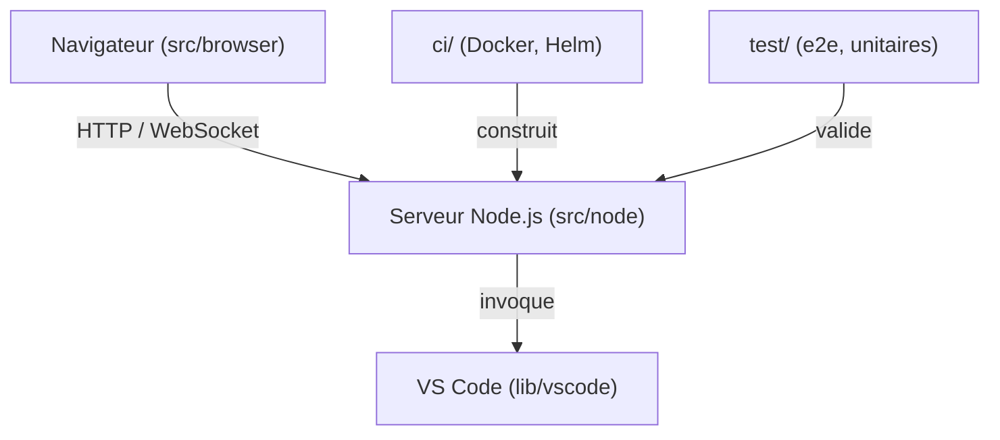

# coder/code-server

> Exécute VS Code sur un serveur et l'ouvre dans un navigateur, pour développer depuis n'importe quel appareil.

## Le problème
Un portable ou une tablette ne suffit pas pour compiler, tester ou télécharger gros. Garder le même environnement partout est pénible.

## Ce que ça fait vraiment
Serveur Node.js qui sert l'interface de VS Code au navigateur via HTTP et WebSocket. Il gère connexion, proxy de ports et sert le code de VS Code intégré (`lib/vscode`). Les calculs lourds tournent sur le serveur. Des Dockerfiles et un chart Helm existent dans `ci/`.

## Comment c'est branché


## Essayer
```bash
curl -fsSL https://code-server.dev/install.sh | sh -s -- --dry-run
curl -fsSL https://code-server.dev/install.sh | sh
```

## Coût et pièges
Gratuit, mais il faut une machine Linux avec WebSockets, 1 Go de RAM et 2 vCPU au minimum. Le serveur est exposé : à protéger.

## Ce que ce n'est pas
Pas une plateforme multi-utilisateurs : pour gérer une équipe, le README renvoie à coder/coder.

## Alternatives
- coder/coder : gérer des environnements de développement pour toute une équipe.

## Pour toi
À adopter : tu codes dans le navigateur sur un serveur GPU ou une VM, sans rien installer sur ton poste.

