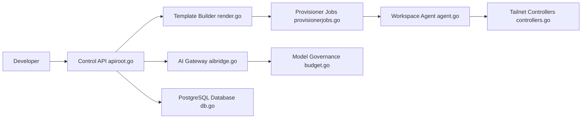

# coder/coder

> Self-hosted platform for cloud dev environments defined in Terraform, with AI coding agents.

## The problem
Onboarding developers takes days, machines sit idle, and LLM keys end up copied onto every workstation.

## What it actually does
Workspaces described as Terraform templates (EC2 VMs, Kubernetes pods, Docker containers), connected by a WireGuard tunnel.
Automatic shutdown of idle resources.
"Coder Agents": an AI agent loop run in the control plane, with no LLM key in the workspaces; AI Gateway for auth, audit and budget.
IDE connection (VS Code, JetBrains), devcontainers, one MCP server per workspace.

## How it is wired


## Trying it
```bash
curl -L https://coder.com/install.sh | sh
coder server
coder server --postgres-url <url> --access-url <url>
```

## Cost and gotchas
Production: PostgreSQL ≥ 13 and an external access URL; workspace infrastructure is at your expense. "Premium" features are paid.

## What it is not
Not an IDE: it provisions the infrastructure where your IDEs run. Without an external database, evaluation mode only (`*.try.coder.app`).

## Alternatives
No alternative named in the README.

## For you
Worth watching: relevant for offering standardized GPU workspaces to an ML team, heavy for solo use.
