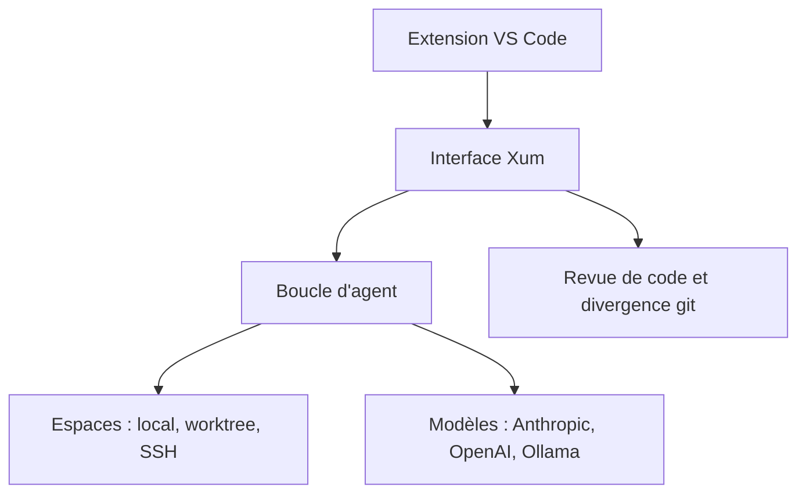

# coder/mux

> Desktop application to drive several coding agents in parallel in isolated workspaces.

## The problem
Running several coding agents on the same repository causes collisions and you lose the overview.

## What it actually does
In-house agent loop, inspired by Claude Code (Plan/Exec mode, /compact), in local workspaces, git worktrees or over SSH. Multi-model (Anthropic, xAI, OpenAI, Ollama, OpenRouter), built-in code review, git divergence tracking, costs and tokens, VS Code extension, server mode. The project was renamed Xum (trademark dispute).

## How it is wired
Simplified diagram based on the sheet, no diagram provided.


## Trying it
```bash
# Aucune commande dans le README : télécharger les binaires macOS/Linux depuis la page des releases.
```

## Cost and gotchas
You pay for model calls (API key) except with local Ollama. Binaries provided for macOS and Linux only.

## What it is not
Not a model nor a full IDE. AGPL: be careful if you embed it in a service.

## Alternatives
No alternative named in the README.

## For you
Watch: interesting for orchestrating coding agents, but the project is changing its name and the AGPL limits reuse.
