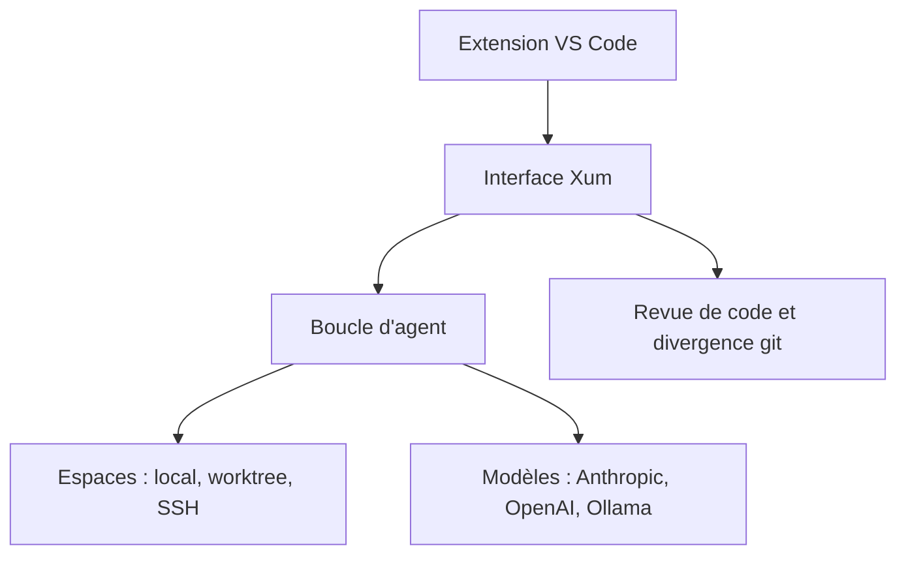

# coder/mux

> Application de bureau pour piloter plusieurs agents de code en parallèle dans des espaces isolés.

## Le problème
Lancer plusieurs agents de code sur un même dépôt provoque des collisions et on perd la vue d'ensemble.

## Ce que ça fait vraiment
Boucle d'agent maison, inspirée de Claude Code (mode Plan/Exec, /compact), dans des espaces de travail locaux, en worktree git ou en SSH. Multi-modèles (Anthropic, xAI, OpenAI, Ollama, OpenRouter), revue de code intégrée, suivi des divergences git, coûts et tokens, extension VS Code, mode serveur. Le projet a été renommé Xum (litige de marque).

## Comment c'est branché
Schéma simplifié d'après la fiche, sans diagramme fourni.


## Essayer
```bash
# Aucune commande dans le README : télécharger les binaires macOS/Linux depuis la page des releases.
```

## Coût et pièges
Tu paies les appels aux modèles (clé d'API) sauf avec Ollama en local. Binaires fournis pour macOS et Linux seulement.

## Ce que ce n'est pas
Pas un modèle ni un IDE complet. AGPL : attention si tu l'intègres dans un service.

## Alternatives
Aucune alternative nommée dans le README.

## Pour toi
Surveiller : intéressant pour orchestrer des agents de code, mais le projet change de nom et l'AGPL limite la réutilisation.

