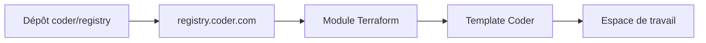

# coder/registry

> Community registry of Terraform modules to extend Coder development workspaces.

## The problem
Adding tools (editors, JetBrains, Cursor) to a remote development environment means rewriting Terraform every time.

## What it actually does
The repository gathers reusable Terraform modules, published on the registry website that mirrors it. You paste a snippet into a Coder template, and the feature appears the next time a workspace is created. Modules in the Coder namespace are verified, others are not.

## How it is wired
Simplified diagram based on the sheet, no diagram provided.



## Trying it
```tf
module "cursor" {
  count    = data.coder_workspace.me.start_count
  source   = "registry.coder.com/coder/cursor/coder"
  version  = "1.0.19"
  agent_id = coder_agent.main.id
}
```

## Cost and gotchas
A Coder deployment is required, and it is not documented here. Third-party modules are not guaranteed unless marked as verified. The templates are still in coder/coder.

## What it is not
It is not Coder itself nor a standalone tool: it is a catalog of modules.

## Alternatives
- coder/coder: main repository, where the official templates live.

## For you
Watch: interesting for remote development environments, including for AI teams, provided you use Coder.
