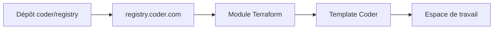

# coder/registry

> Registre communautaire de modules Terraform pour étendre les espaces de travail de développement Coder.

## Le problème
Ajouter des outils (éditeurs, JetBrains, Cursor) à un environnement de développement distant oblige à réécrire du Terraform à chaque fois.

## Ce que ça fait vraiment
Le dépôt rassemble des modules Terraform réutilisables, publiés sur le site du registre qui en est le miroir. On colle un extrait dans un template Coder, et la fonctionnalité apparaît à la prochaine création d'espace. Les modules du namespace Coder sont vérifiés, les autres non.

## Comment c'est branché
Schéma simplifié d'après la fiche, sans diagramme fourni.



## Essayer
```tf
module "cursor" {
  count    = data.coder_workspace.me.start_count
  source   = "registry.coder.com/coder/cursor/coder"
  version  = "1.0.19"
  agent_id = coder_agent.main.id
}
```

## Coût et pièges
Il faut un déploiement Coder, qui n'est pas documenté ici. Les modules tiers ne sont pas garantis tant qu'ils ne sont pas marqués vérifiés. Les templates sont encore dans coder/coder.

## Ce que ce n'est pas
Ce n'est pas Coder lui-même ni un outil seul : c'est un catalogue de modules.

## Alternatives
- coder/coder : dépôt principal, où se trouvent les templates officiels.

## Pour toi
Surveiller : intéressant pour des environnements de dev distants, y compris pour des équipes IA, à condition d'utiliser Coder.

