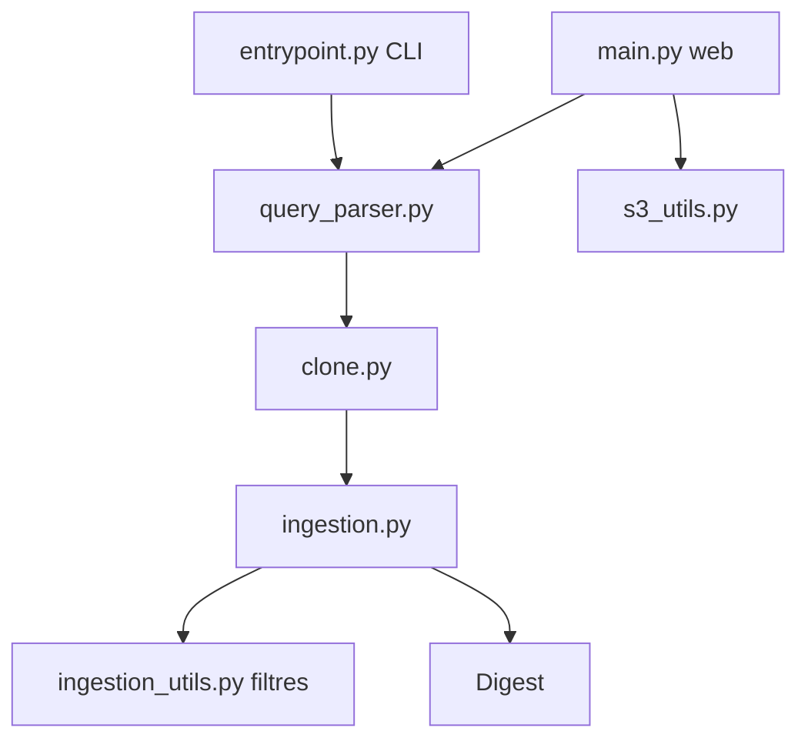

# coderamp-labs/gitingest

> Turns a Git repository or a folder into a single text ready to paste into an LLM prompt.

## The problem
Giving an LLM the context of a repository means copying files one by one, with no structure and no idea of the token count.

## What it actually does
From a GitHub URL (including a subfolder) or a local folder, it produces the directory tree and the file contents, with the size and the token count (tiktoken).
It respects `.gitignore`, and accepts tokens for private repositories and submodules.
It can be used as a CLI (`digest.txt` or stdout), as a sync or async Python package (Jupyter), through a browser extension or a self-hosted FastAPI server.

## How it is wired


## Trying it
```bash
pip install gitingest
pipx install gitingest
gitingest /path/to/directory
gitingest https://github.com/coderamp-labs/gitingest
docker build -t gitingest .
docker run -d --name gitingest -p 8000:8000 gitingest
```

## Cost and gotchas
It is free. The server version embeds PostHog and Sentry, which sends PII by default (`SEND_DEFAULT_PII=true`) when enabled.

## What it is not
Not a semantic index or a RAG: it is a plain text dump, which quickly exceeds the context window on a large repository.

## Alternatives
- Repomix: the JavaScript/npm equivalent.

## For you
Adopt: `pip install` then a single command to give a whole repository to an LLM. An immediate time saver for reading code or documenting it.
