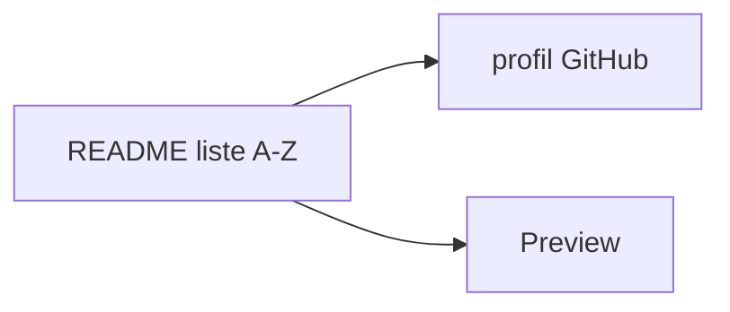

# coderjojo/creative-profile-readme

> Alphabetical list of developer GitHub profiles, for inspiration when writing your own profile README.

## The problem
Writing your GitHub profile README without examples in front of you: you don't know what to show.

## What it actually does
- List of names sorted A to Z, each followed by a "Preview" link.
- A few "profile deleted or username changed" notes: some entries are already dead.
- Inspired by the Developer Portfolios repo.
- No tool, no code.

## How it is wired

## Trying it
No commands documented: open the README and follow the links.

## Cost and gotchas
Free. Archived repo: no more updates, links likely to break.

## What it is not
Not a README generator, not a writing guide. No license declared.

## Alternatives
Developer Portfolios (cited as a source of inspiration).

## For you
Ignore: archived, unlicensed, and nothing useful for data / AI / MLOps work.
