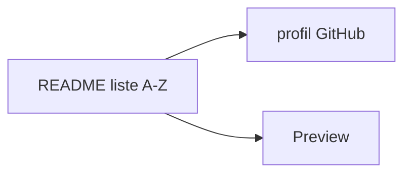

# coderjojo/creative-profile-readme

> Liste alphabétique de profils GitHub de développeurs, pour s'inspirer en écrivant son propre README de profil.

## Le problème
Écrire le README de son profil GitHub sans exemples sous les yeux : on ne sait pas quoi montrer.

## Ce que ça fait vraiment
- Liste de noms classés de A à Z, chacun suivi d'un lien « Preview ».
- Quelques mentions « profile deleted or username changed » : des entrées sont déjà mortes.
- S'inspire du dépôt Developer Portfolios.
- Aucun outil, aucun code.

## Comment c'est branché

## Essayer
Aucune commande documentée : ouvrir le README et suivre les liens.

## Coût et pièges
Gratuit. Dépôt archivé : plus de mises à jour, liens susceptibles de casser.

## Ce que ce n'est pas
Pas un générateur de README, pas un guide de rédaction. Pas de licence déclarée.

## Alternatives
Developer Portfolios (cité comme source d'inspiration).

## Pour toi
À ignorer : archivé, sans licence, et rien d'utile pour un travail data / IA / MLOps.

