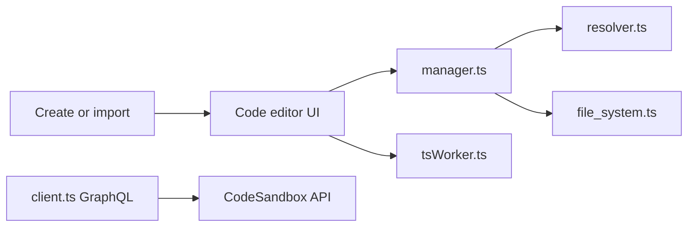

# codesandbox/codesandbox-client

> Web client of the CodeSandbox online IDE for prototyping web applications in the browser.

## The problem
Starting a web development environment requires a local installation before writing the first line.

## What it actually does
Web application to create or import a project, edit and run the code in a sandbox, then share it. The Sandpack manager resolves modules, fetches dependencies and transpiles; BrowserFS and Monaco/TypeScript provide the file system and the editor.

## How it is wired


## Trying it
```bash
# Aucune commande documentée dans ce README :
# le produit s'utilise en ligne, la documentation est sur le site.
```

## Cost and gotchas
The client depends on the CodeSandbox API and other servers, only some of which are open source. License not identified by GitHub.

## What it is not
It is not a standalone self-hostable IDE: the README lists other repositories (server, nginx, git extractor, CLI).

## Alternatives
Not documented: the README names no alternative.

## For you
Keep an eye on it: useful as a reference for an in-browser IDE, but hard to use on its own for data/AI, and dependent on a service.
