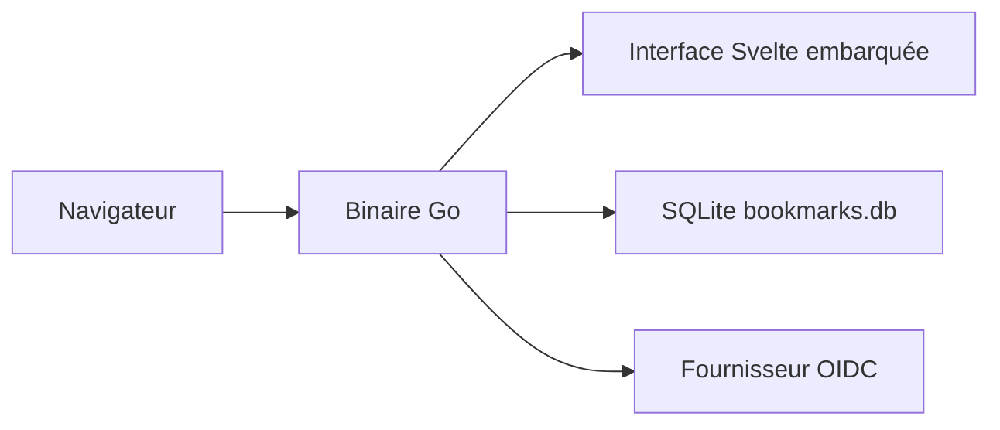

# codewec/dashlit

> Self-hosted dashboard of links and services, in a single Go binary.

## The problem
Finding all the services of a homelab without digging through bookmarks or remembering addresses.

## What it actually does
Several dashboards (public, authenticated or private), drag and drop, URL availability tracking, local or OIDC authentication. The data fits in SQLite. The Go binary embeds the Svelte interface.

## How it is wired
Simplified diagram based on the sheet, no diagram provided.


## Trying it
```bash
docker pull ghcr.io/codewec/dashlit:latest
docker run -d --name dashlit --restart unless-stopped -p 3000:8080 \
  -e JWT_SECRET='replace-with-a-long-random-secret' \
  -v dashlit-data:/data ghcr.io/codewec/dashlit:latest
```

## Cost and gotchas
Free. The first account created becomes administrator. Updates query GitHub unless `UPDATE_CHECK_ENABLED=false`. An install script goes through `curl | sudo bash`.

## What it is not
Not a full monitoring tool: only URL availability status. Nothing for AI or data.

## Alternatives
No alternative named in the README, apart from the old version of DashLit for migration.

## For you
Worth watching: useful for a homelab, unrelated to your job; its value depends on the time you devote to your personal infrastructure.
