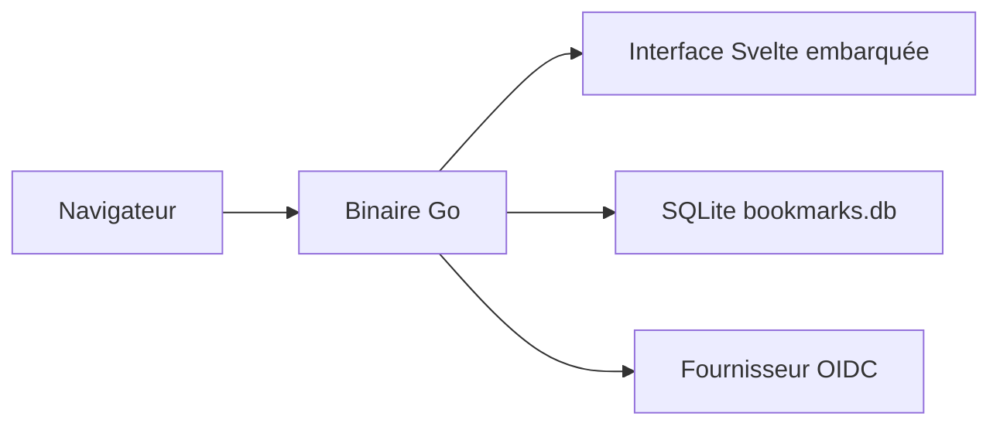

# codewec/dashlit

> Tableau de bord auto-hébergé de liens et de services, en un seul binaire Go.

## Le problème
Retrouver tous les services d'un homelab sans fouiller les favoris ni retenir les adresses.

## Ce que ça fait vraiment
Plusieurs tableaux de bord (publics, authentifiés ou privés), glisser-déposer, suivi de disponibilité des URL, authentification locale ou OIDC. Les données tiennent dans SQLite. Le binaire Go embarque l'interface Svelte.

## Comment c'est branché
Schéma simplifié d'après la fiche, sans diagramme fourni.


## Essayer
```bash
docker pull ghcr.io/codewec/dashlit:latest
docker run -d --name dashlit --restart unless-stopped -p 3000:8080 \
  -e JWT_SECRET='replace-with-a-long-random-secret' \
  -v dashlit-data:/data ghcr.io/codewec/dashlit:latest
```

## Coût et pièges
Gratuit. Le premier compte créé devient administrateur. Les mises à jour interrogent GitHub sauf si `UPDATE_CHECK_ENABLED=false`. Un script d'installation passe par `curl | sudo bash`.

## Ce que ce n'est pas
Pas un outil de supervision complet : seulement l'état de disponibilité des URL. Rien pour l'IA ou les données.

## Alternatives
Aucune alternative nommée dans le README, hormis l'ancienne version de DashLit pour la migration.

## Pour toi
À surveiller : sert pour un homelab, sans rapport avec ton métier ; sa valeur dépend du temps que tu consacres à ton infrastructure perso.

