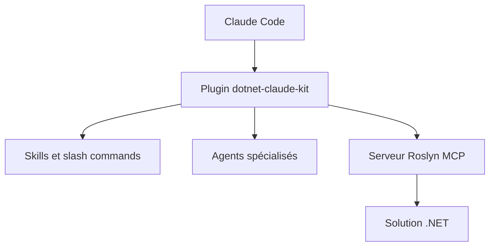

# codewithmukesh/dotnet-claude-kit

> Claude Code plugin bundling skills, agents and a Roslyn MCP server for writing idiomatic .NET 10.

## The problem
Out of the box, Claude Code produces generic C#, picks an architecture without asking you, and reads whole files instead of targeted queries.

## What it actually does
Brings 52 skills, 11 agents, 17 commands (`/dotnet-init`, `/scaffold`, `/arch-check`), 10 rules and 7 CLAUDE.md templates. The CWM.RoslynNavigator server offers 26 MCP tools for semantic analysis. Hooks format on edit and block destructive commands. The README cites speed and accuracy gains measured by the author.

## How it is wired
Simplified diagram based on the sheet, no diagram provided.


## Trying it
```bash
dotnet tool install -g CWM.RoslynNavigator
/plugin marketplace add codewithmukesh/dotnet-claude-kit
/plugin install dotnet-claude-kit
/dotnet-init
```

## Cost and gotchas
Free, but requires the .NET SDK and a Claude Code account. The 10 rules must be copied by hand into `.claude/rules/`. The README is truncated in the provided material: the detail of the measurements was not read.

## What it is not
Not a .NET library: it does not run inside your application. It is only useful with Claude Code.

## Alternatives
Not documented in the README.

## For you
Ignore: specific to .NET development, no benefit for a data / AI / MLOps profile, unless you maintain C# code.
