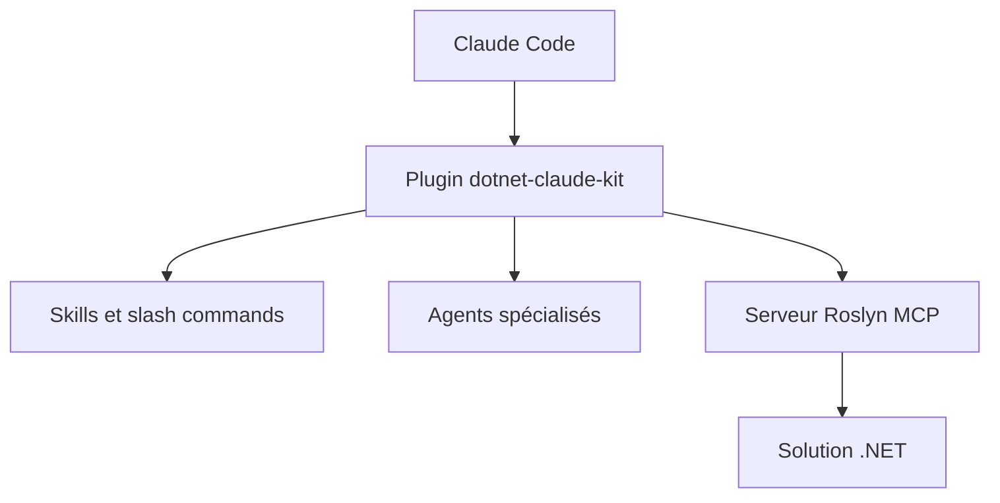

# codewithmukesh/dotnet-claude-kit

> Plugin Claude Code regroupant compétences, agents et serveur Roslyn MCP pour écrire du .NET 10 idiomatique.

## Le problème
Hors configuration, Claude Code produit un C# générique, choisit une architecture sans te demander et lit des fichiers entiers au lieu de requêtes ciblées.

## Ce que ça fait vraiment
Apporte 52 compétences, 11 agents, 17 commandes (`/dotnet-init`, `/scaffold`, `/arch-check`), 10 règles et 7 modèles de CLAUDE.md. Le serveur CWM.RoslynNavigator offre 26 outils MCP d'analyse sémantique. Des hooks formatent à l'édition et bloquent les commandes destructrices. Le README cite des gains de vitesse et de précision mesurés par l'auteur.

## Comment c'est branché
Schéma simplifié d'après la fiche, sans diagramme fourni.


## Essayer
```bash
dotnet tool install -g CWM.RoslynNavigator
/plugin marketplace add codewithmukesh/dotnet-claude-kit
/plugin install dotnet-claude-kit
/dotnet-init
```

## Coût et pièges
Gratuit, mais demande le SDK .NET et un compte Claude Code. Les 10 règles sont à copier à la main dans `.claude/rules/`. Le README est tronqué dans la matière fournie : le détail des mesures n'a pas été lu.

## Ce que ce n'est pas
Ce n'est pas une bibliothèque .NET : il ne s'exécute pas dans ton application. Il n'est utile qu'avec Claude Code.

## Alternatives
Non documenté dans le README.

## Pour toi
À ignorer : spécifique au développement .NET, sans apport pour un profil data / IA / MLOps, sauf si tu maintiens du code C#.

