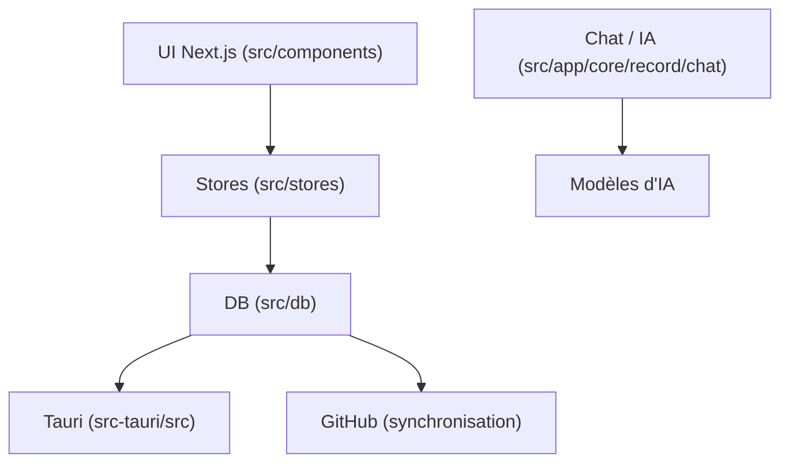

# codexu/note-gen

> Local Markdown note-taking app that gathers fragments and organizes them with AI.

## The problem
Ideas arrive in a jumble (sentences, screenshots, links) and get lost before being structured.

## What it actually does
Captures records (text, voice, image, link, file), then the AI, through the providers you configure, organizes them into a Markdown note. Notes are stored as ordinary Markdown files in a folder of your choice. Knowledge base with hybrid search, MCP, Skills, Agent mode, canvases (mind maps, diagrams). Sync through GitHub, GitLab, Gitee, Gitea, S3 or WebDAV.

## How it is wired

## Trying it
No command in the README: download the app for your platform, choose a working folder, configure an AI provider. Windows, macOS and Linux are in beta; Android and iOS in alpha.

## Cost and gotchas
Free, but AI calls, OCR and embeddings use your provider API key. Beta or alpha versions. GPL-3.0.

## What it is not
Not an editor that writes everything by itself: the AI proposes, you edit. No synchronization through an imposed proprietary service.

## Alternatives
No alternative named in the README; companion repositories exist (note-gen-server, note-gen-clipper).

## For you
Worth watching: interesting for a personal knowledge base with MCP and Skills, but still in beta and carried by a single maintainer.
