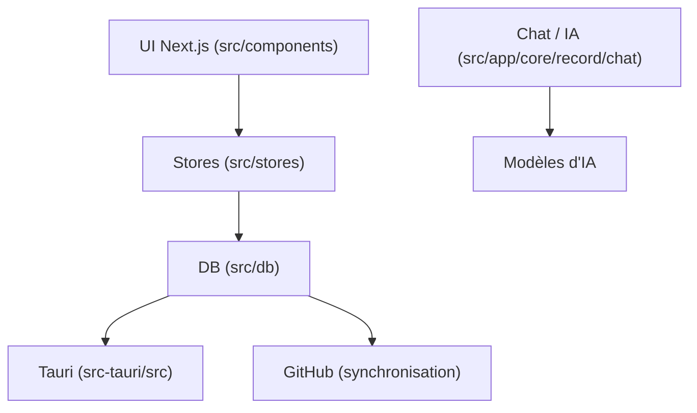

# codexu/note-gen

> Application de notes Markdown locale qui rassemble des fragments et les organise avec une IA.

## Le problème
Les idées arrivent en vrac (phrases, captures, liens) et se perdent avant d'être structurées.

## Ce que ça fait vraiment
Capture des enregistrements (texte, voix, image, lien, fichier), puis l'IA, via les fournisseurs que tu configures, les organise en note Markdown. Notes stockées en fichiers Markdown ordinaires dans un dossier choisi. Base de connaissances avec recherche hybride, MCP, Skills, mode Agent, canevas (cartes mentales, diagrammes). Synchronisation par GitHub, GitLab, Gitee, Gitea, S3 ou WebDAV.

## Comment c'est branché

## Essayer
Aucune commande dans le README : télécharger l'application pour la plateforme, choisir un dossier de travail, configurer un fournisseur d'IA. Windows, macOS et Linux sont en bêta ; Android et iOS en alpha.

## Coût et pièges
Gratuit, mais les appels d'IA, l'OCR et les embeddings utilisent ta clé d'API de fournisseur. Versions en bêta ou alpha. GPL-3.0.

## Ce que ce n'est pas
Pas un éditeur qui écrit tout seul : l'IA propose, tu édites. Pas de synchronisation par un service propriétaire imposé.

## Alternatives
Aucune alternative nommée dans le README ; des dépôts compagnons existent (note-gen-server, note-gen-clipper).

## Pour toi
À surveiller : intéressant pour une base de connaissances personnelle avec MCP et Skills, mais encore en bêta et porté par un seul mainteneur.

