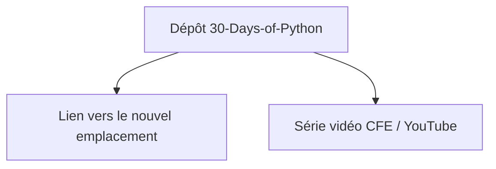

# codingforentrepreneurs/30-Days-of-Python

> Former 30-day course for learning Python, moved elsewhere: for beginners.

## The problem
Learning Python with no framework or progression. Here, the content is no longer in this repository.

## What it actually does
The README is only a pointer: the tutorial (Python 3.6) has been moved to another location. It also points to a video series on CFE and YouTube. The teaching content itself is not described.

## How it is wired
Simplified diagram based on the sheet, no diagram provided.

## Trying it
No documented command. You have to follow the link to the new location.

## Cost and gotchas
Free. Main gotcha: the repository is a signpost, last push in February 2024, and targets Python 3.6.

## What it is not
Not the course itself: the content has moved. Not up to date: Python 3.6 is old.

## Alternatives
No alternative named in the README.

## For you
Ignore: the README only contains a pointer to a Python 3.6 course, of no interest for a data / AI profile that already knows how to program.
