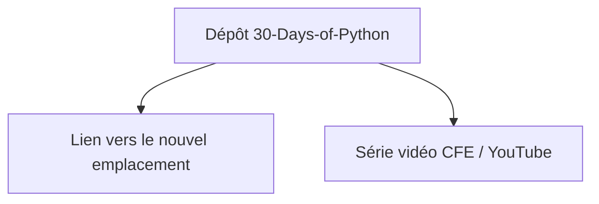

# codingforentrepreneurs/30-Days-of-Python

> Ancien parcours de 30 jours pour apprendre Python, déménagé ailleurs : pour débutants.

## Le problème
Apprendre Python sans cadre ni progression. Ici, le contenu n'est plus dans ce dépôt.

## Ce que ça fait vraiment
Le README n'est qu'un renvoi : le tutoriel (Python 3.6) a été déplacé vers un autre emplacement. Il renvoie aussi à une série vidéo sur CFE et YouTube. Le contenu pédagogique lui-même n'est pas décrit.

## Comment c'est branché
Schéma simplifié d'après la fiche, sans diagramme fourni.

## Essayer
Aucune commande documentée. Il faut suivre le lien vers le nouvel emplacement.

## Coût et pièges
Gratuit. Piège principal : le dépôt est un panneau indicateur, dernier push en février 2024, et vise Python 3.6.

## Ce que ce n'est pas
Pas le cours lui-même : le contenu a déménagé. Pas à jour : Python 3.6 est ancien.

## Alternatives
Aucune alternative nommée dans le README.

## Pour toi
À ignorer : le README ne contient qu'un renvoi vers un cours Python 3.6, sans intérêt pour un profil data / IA qui sait déjà programmer.

