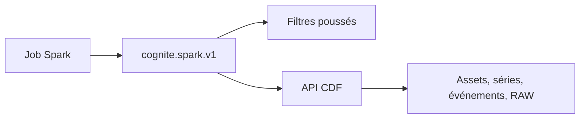

# cognitedata/cdp-spark-datasource

> Spark data source for reading from and writing to Cognite Data Fusion, for industrial data teams.

## The problem
Reading and writing Cognite assets, time series and events from Spark means handling the API, pagination and parallelism yourself.

## What it actually does
The `cognite.spark.v1` connector reads and writes assets, time series, data points, events and RAW tables; it reads file and 3D model metadata. Filters are pushed down to the API, and calls are parallel and asynchronous. An asset hierarchy builder exists in beta.

## How it is wired
Simplified diagram based on the sheet, no diagram provided.



## Trying it
```python
df = spark.read.format("cognite.spark.v1")
  .option("type", "assets")
  .load()
df.count
```

## Cost and gotchas
You need a Cognite Data Fusion project and authentication (token or OIDC). Use `--packages` rather than `--jars`. Cognite pricing is not in the README.

## What it is not
It is not a generic connector: it only serves Cognite Data Fusion. The hierarchy builder is a beta judged insufficiently tested for production.

## Alternatives
No alternative named in the README.

## For you
Worth watching: relevant if your industrial data lives in Cognite and you work with Spark, otherwise off-topic.
