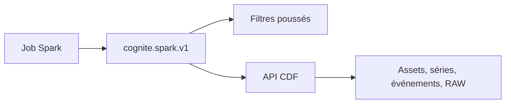

# cognitedata/cdp-spark-datasource

> Source de données Spark pour lire et écrire dans Cognite Data Fusion, pour les équipes de données industrielles.

## Le problème
Lire et écrire des actifs, séries temporelles et événements Cognite depuis Spark exige de gérer soi-même l'API, la pagination et le parallélisme.

## Ce que ça fait vraiment
Le connecteur `cognite.spark.v1` lit et écrit assets, séries temporelles, points de données, événements et tables RAW ; il lit les métadonnées de fichiers et de modèles 3D. Les filtres sont poussés vers l'API, les appels sont parallèles et asynchrones. Un constructeur de hiérarchies d'actifs existe en bêta.

## Comment c'est branché
Schéma simplifié d'après la fiche, sans diagramme fourni.



## Essayer
```python
df = spark.read.format("cognite.spark.v1")
  .option("type", "assets")
  .load()
df.count
```

## Coût et pièges
Il faut un projet Cognite Data Fusion et une authentification (jeton ou OIDC). Utilise `--packages` et non `--jars`. Les tarifs Cognite ne sont pas dans le README.

## Ce que ce n'est pas
Ce n'est pas un connecteur générique : il ne sert qu'à Cognite Data Fusion. Le constructeur de hiérarchies est une bêta jugée insuffisamment testée pour la production.

## Alternatives
Aucune alternative nommée dans le README.

## Pour toi
À surveiller : pertinent si tes données industrielles sont dans Cognite et que tu travailles avec Spark, sinon hors sujet.

