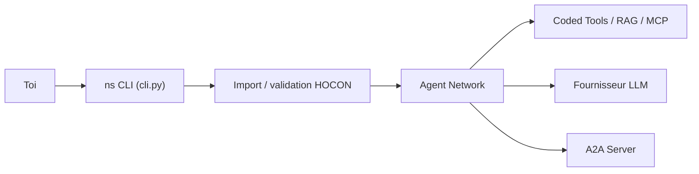

# cognizant-ai-lab/neuro-san-studio

> Playground for the Neuro SAN library: agent networks described in HOCON, with examples and a UI.

## The problem
Assembling multi-agent systems takes a lot of code, and domain experts cannot configure them.

## What it actually does
A `ns` CLI that creates a project (`ns init`), imports example networks, and launches the server and the nsflow UI (`ns run`). Agent networks are declared in HOCON with Python tools ("coded tools"), MCP, A2A, RAG, and a meta-agent, the Agent Network Designer, that generates new networks. Sly-data keeps sensitive data away from the LLMs.

## How it is wired


## Trying it
```bash
uv init
uv venv
source .venv/bin/activate
uv add neuro-san-studio
ns init
ns check-llm-keys
ns run
```

## Cost and gotchas
An OpenAI, Anthropic or Gemini key is required (BYOK), so the LLM bill is on you. Server on localhost:8080, UI on :4173. 130 open issues. The "High level Architecture" section of the README is empty.

## What it is not
Not a finished product: it is the examples studio of the separate neuro-san library. The use cases are demos.

## Alternatives
The README mentions CrewAI, LangChain, Agentforce and Agentspace as ecosystems it can integrate with, not as competitors.

## For you
Worth watching: interesting for quickly prototyping declarative multi-agent setups, less so if you prefer pure Python code.
