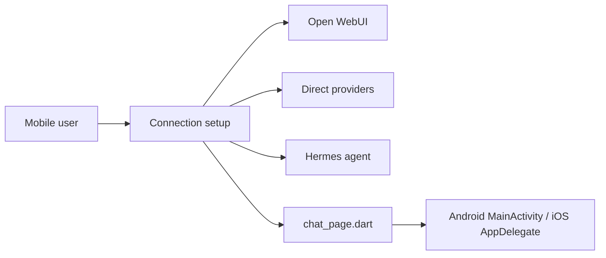

# cogwheel0/conduit

> Flutter mobile client for Open WebUI, direct model endpoints and self-hosted Hermes agents.

## The problem
Open WebUI works poorly on mobile: authentication behind a proxy, streaming cut off in the background, screenshot sharing.

## What it actually does
Native Flutter application with five connection modes: Open WebUI, Direct (OpenAI-compatible, Ollama, OpenRouter), Apple On-Device, Apple PCC and Hermes agent. WebSocket streaming, Mermaid and LaTeX rendering, notes, voice, widgets. Credentials in Keychain/Keystore, no third-party analytics; chats stay on the device.

## How it is wired


## Trying it
```bash
git clone --recursive https://github.com/cogwheel0/conduit.git
cd conduit
flutter pub get
dart run build_runner build
flutter run -d ios   # or: flutter run -d android
```

## Cost and gotchas
You need an Open WebUI server or a model provider (possibly an API key). The Apple modes require iOS 26 or 27 and Apple Intelligence.

## What it is not
Not a server: it is a client. Features depend on what your deployment exposes. GPL-3.0 license.

## Alternatives
No alternative named in the README.

## For you
Worth watching: useful if you host Open WebUI or Ollama and want mobile access; GPL-3.0 must be taken into account for any reuse.
