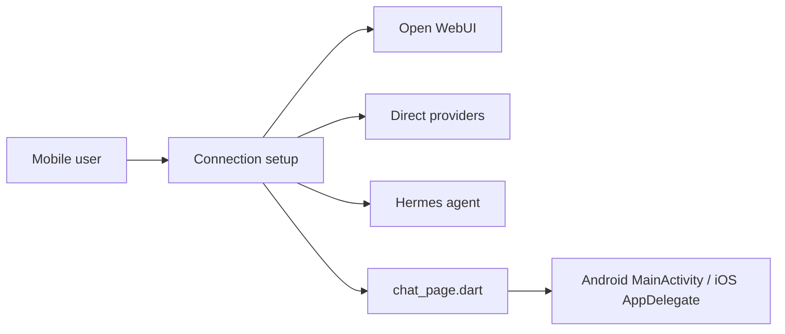

# cogwheel0/conduit

> Client mobile Flutter pour Open WebUI, endpoints de modèles directs et agents Hermes auto-hébergés.

## Le problème
Open WebUI fonctionne mal sur mobile : authentification derrière proxy, streaming coupé en arrière-plan, partage de captures d'écran.

## Ce que ça fait vraiment
Application Flutter native avec cinq modes de connexion : Open WebUI, Direct (OpenAI-compatible, Ollama, OpenRouter), Apple On-Device, Apple PCC et agent Hermes. Streaming WebSocket, rendu Mermaid et LaTeX, notes, voix, widgets. Identifiants dans Keychain/Keystore, pas d'analytique tierce ; les chats restent sur l'appareil.

## Comment c'est branché


## Essayer
```bash
git clone --recursive https://github.com/cogwheel0/conduit.git
cd conduit
flutter pub get
dart run build_runner build
flutter run -d ios   # or: flutter run -d android
```

## Coût et pièges
Il faut un serveur Open WebUI ou un fournisseur de modèle (clé d'API éventuelle). Les modes Apple exigent iOS 26 ou 27 et Apple Intelligence.

## Ce que ce n'est pas
Pas un serveur : c'est un client. Les fonctions dépendent de ce que ton déploiement expose. Licence GPL-3.0.

## Alternatives
Aucune alternative nommée dans le README.

## Pour toi
À surveiller : utile si tu héberges Open WebUI ou Ollama et veux un accès mobile ; GPL-3.0 à prendre en compte pour toute réutilisation.

