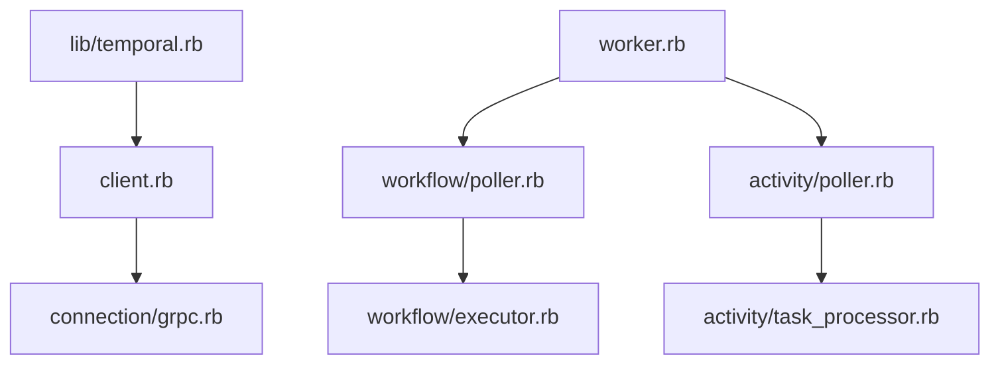

# coinbase/temporal-ruby

> Pure Ruby SDK for defining and running Temporal workflows and activities.

## The problem
Orchestrating long-running, reliable processes in Ruby without writing retries, timers and durable state yourself.

## What it actually does
You write `Temporal::Workflow` classes (deterministic) and `Temporal::Activity` classes (idempotent), which a `Temporal::Worker` registers. The worker starts pollers that fetch tasks from the Temporal server over gRPC, process them and send back serialized results. Signals, timers, children, queries, cron and middlewares.

## How it is wired


## Trying it
```bash
curl -O https://raw.githubusercontent.com/temporalio/docker-compose/main/docker-compose.yml
docker-compose up
```
```ruby
gem 'temporal-ruby', github: 'coinbase/temporal-ruby'
Temporal.start_workflow(HelloWorldWorkflow)
```

## Cost and gotchas
A Temporal server is required (Docker Compose provided). A workflow's code must stay deterministic; any change of shape requires `workflow.has_release?`. The testing framework is limited.

## What it is not
Not the Temporal server: only the Ruby client. The README's TODO acknowledges missing features.

## Alternatives
No alternative named in the README.

## For you
Ignore: Ruby SDK, whereas Temporal also serves ML pipelines through other SDKs; reconsider only within a Ruby team.
