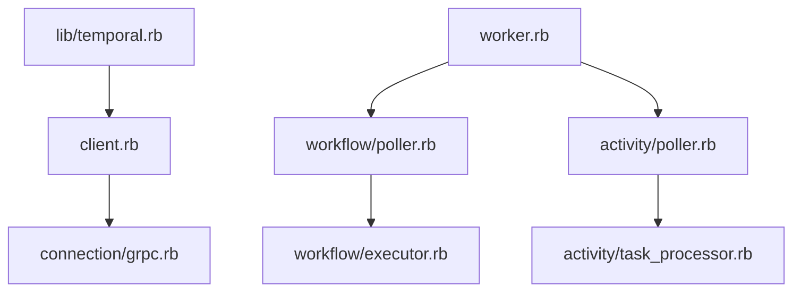

# coinbase/temporal-ruby

> SDK Ruby pur pour définir et exécuter des workflows et activités Temporal.

## Le problème
Orchestrer des processus longs et fiables en Ruby sans écrire soi-même reprises, minuteries et état durable.

## Ce que ça fait vraiment
On écrit des classes `Temporal::Workflow` (déterministes) et `Temporal::Activity` (idempotentes), qu'un `Temporal::Worker` enregistre. Le worker lance des pollers qui récupèrent les tâches du serveur Temporal par gRPC, les traitent et renvoient les résultats sérialisés. Signaux, minuteries, enfants, requêtes, cron et middlewares.

## Comment c'est branché


## Essayer
```bash
curl -O https://raw.githubusercontent.com/temporalio/docker-compose/main/docker-compose.yml
docker-compose up
```
```ruby
gem 'temporal-ruby', github: 'coinbase/temporal-ruby'
Temporal.start_workflow(HelloWorldWorkflow)
```

## Coût et pièges
Il faut un serveur Temporal (Docker Compose fourni). Le code d'un workflow doit rester déterministe ; tout changement de forme demande `workflow.has_release?`. Le cadre de test est limité.

## Ce que ce n'est pas
Pas le serveur Temporal : seulement le client Ruby. Le TODO du README reconnaît des fonctions manquantes.

## Alternatives
Aucune alternative nommée dans le README.

## Pour toi
Ignorer : SDK Ruby, alors que Temporal sert aussi aux pipelines ML via d'autres SDK ; à reconsidérer seulement dans une équipe Ruby.

