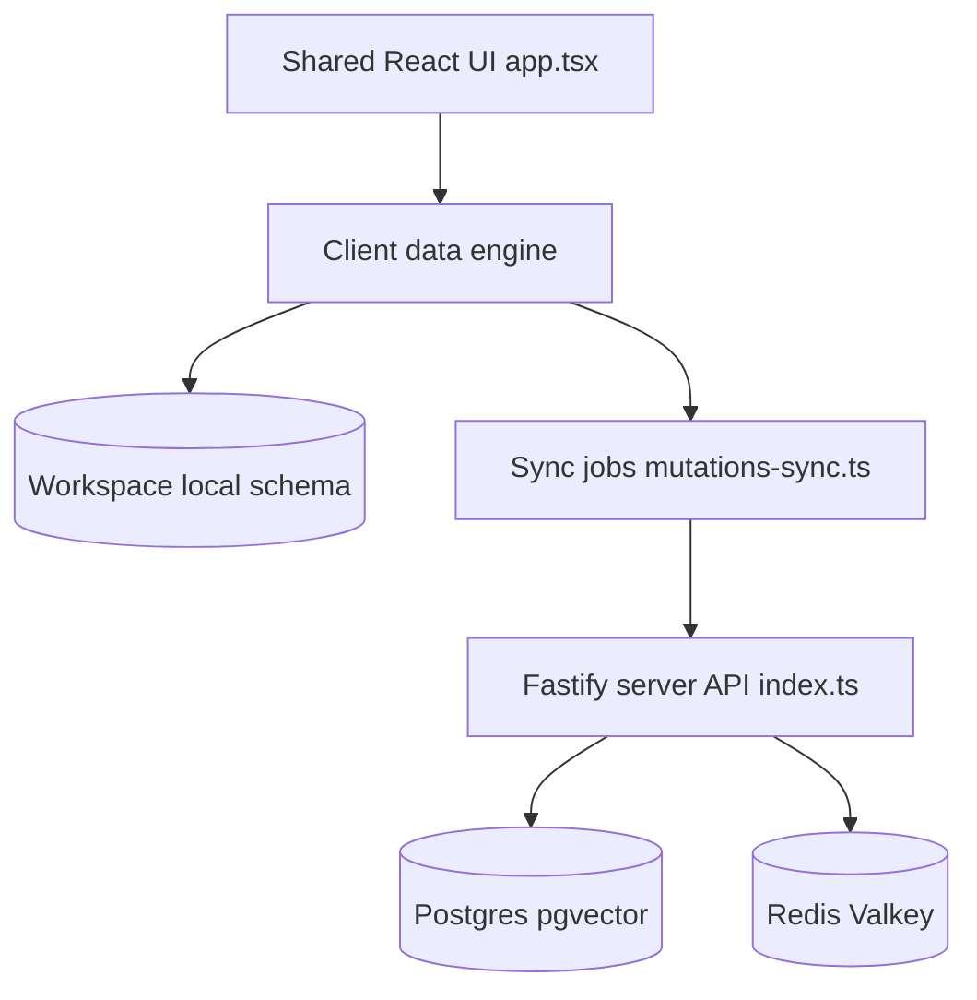

# colanode/colanode

> Open-source, local-first, self-hostable collaboration workspace: chat, pages, databases, files.

## The problem
Collaboration tools lock your data in with the vendor and do not work offline.

## What it actually does
Changes go first into a local SQLite database and are then synchronized with the server. Pages and records use CRDTs (Yjs) for concurrent editing. The Fastify server relies on Postgres with pgvector and Redis; files go to local storage, S3, GCS or Azure. Web, Electron and mobile clients.

## How it is wired


## Trying it
```bash
git clone https://github.com/colanode/colanode.git
cd colanode
npm install
docker compose -f hosting/docker/docker-compose.yaml up -d
cd apps/server && cp .env.example .env && npm run dev
```

## Cost and gotchas
Self-hosting: Postgres with pgvector, Redis and storage. The cloud servers (EU, US) are in free beta, pricing to be announced. The web application is a preview. Last push on 2026-04-03.

## What it is not
Not yet a stable product (beta, web preview). Messages and files do not use CRDTs for concurrent editing.

## Alternatives
No alternative named in the README (Notion is cited only as a comparison point for the editor).

## For you
Worth watching: the local-first architecture with CRDTs and pgvector is instructive, but the tool is young and has no direct link with your ML pipeline.
