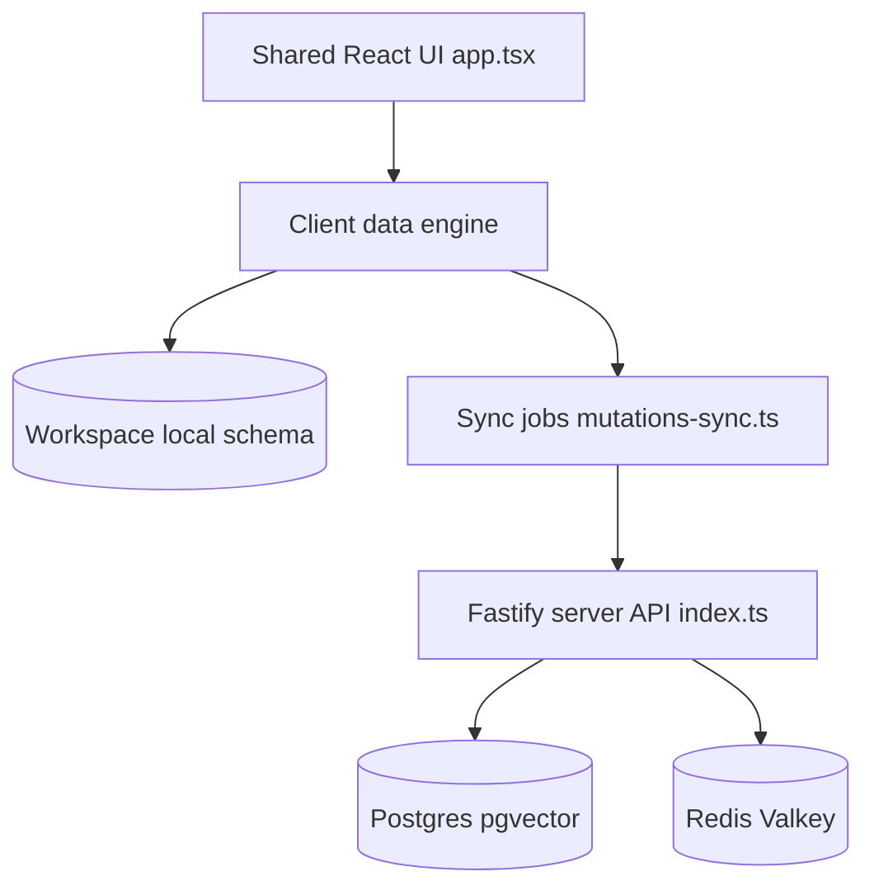

# colanode/colanode

> Espace de collaboration open source et local-first, auto-hébergeable : chat, pages, bases de données, fichiers.

## Le problème
Les outils de collaboration enferment les données chez l'éditeur et ne marchent pas hors ligne.

## Ce que ça fait vraiment
Les modifications vont d'abord dans une base SQLite locale puis se synchronisent avec le serveur. Les pages et enregistrements utilisent des CRDT (Yjs) pour l'édition concurrente. Le serveur Fastify s'appuie sur Postgres avec pgvector et Redis ; les fichiers vont en local, S3, GCS ou Azure. Clients web, Electron et mobile.

## Comment c'est branché


## Essayer
```bash
git clone https://github.com/colanode/colanode.git
cd colanode
npm install
docker compose -f hosting/docker/docker-compose.yaml up -d
cd apps/server && cp .env.example .env && npm run dev
```

## Coût et pièges
Auto-hébergement : Postgres avec pgvector, Redis et stockage. Les serveurs cloud (UE, US) sont en bêta gratuite, tarifs à annoncer. L'application web est en préversion. Dernier push le 2026-04-03.

## Ce que ce n'est pas
Ce n'est pas encore un produit stable (bêta, préversion web). Messages et fichiers n'utilisent pas les CRDT pour l'édition concurrente.

## Alternatives
Aucune alternative nommée dans le README (Notion est cité seulement comme point de comparaison de l'éditeur).

## Pour toi
À surveiller : l'architecture local-first avec CRDT et pgvector est instructive, mais l'outil est jeune et sans lien direct avec ton pipeline ML.

