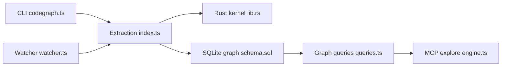

# colbymchenry/codegraph

> Graph of local code branches, linked to the MCP (Main Code Pool), for agents to have targeted context.

## The problem
An engineer rediscovers the code's structure by using tools like `grep` and by examining files one by one: there are many calls to external tools and placeholders before the actual work begins.

## What it actually does
Indexes the project in a local SQLite database (symbols, function calls, imports, framework routes) with a Rust core for 20 languages. The MCP `codegraph_explore` tool returns useful code, call paths, and the impact radius in a single call. A watcher resynchronizes the index with each save. README benchmarks: 44% reduction in cost across 7 repositories, but approximately 80% of context is also available in a long session.

## How it is wired


## Trying it
```bash
curl -fsSL https://raw.githubusercontent.com/colbymchenry/codegraph/main/install.sh | sh
codegraph install
cd your-project
codegraph init
```

## Cost and gotchas
Free, everything is local. A global `codegraph install` is not sufficient; you need `codegraph init` per project. Anonymous telemetry is enabled by default (`codegraph telemetry off`). The API in the library requires Node 22.5+.

## What it is not
This is not a vector semantic search engine. Its accuracy has a static limit (Django achieves 74% route coverage). The cost figures are based on the author's benchmarks for a single query per submission.

## Alternatives
No alternative is named in the README (it mentions a "concurrent indexer" without specifying its name).

## For you
Recommended: If you are using Claude Code or Cursor on large repositories, a local index without an API key will reduce the number of calls and tokens used. Disable telemetry if necessary.
