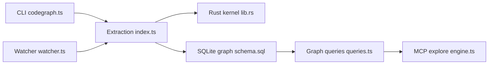

# colbymchenry/codegraph

> Graphe de code local branché en MCP sur les agents de code, pour leur donner du contexte ciblé.

## Le problème
Un agent redécouvre la structure du code à coups de grep et de lectures fichier par fichier : beaucoup d'appels d'outils et de tokens avant le vrai travail.

## Ce que ça fait vraiment
Indexe le projet dans une base SQLite locale (symboles, appels, imports, routes de frameworks) avec un noyau Rust pour 20 langages. L'outil MCP `codegraph_explore` renvoie en un appel le code utile, les chemins d'appel et le rayon d'impact. Un watcher resynchronise l'index à chaque sauvegarde. Benchmarks du README : 44 % de coût en moins sur 7 dépôts, mais environ 80 % de contexte résident en plus en session longue.

## Comment c'est branché


## Essayer
```bash
curl -fsSL https://raw.githubusercontent.com/colbymchenry/codegraph/main/install.sh | sh
codegraph install
cd your-project
codegraph init
```

## Coût et pièges
Gratuit, tout est local. Un `codegraph install` global ne suffit pas : il faut `codegraph init` par projet. La télémétrie anonyme est active par défaut (`codegraph telemetry off`). L'API en bibliothèque exige Node 22.5+.

## Ce que ce n'est pas
Pas un moteur de recherche sémantique vectoriel. La précision a un plafond statique (Django 74 % de couverture de routes). Les chiffres de coût viennent des benchmarks de l'auteur sur une question par dépôt.

## Alternatives
Aucune alternative nommée dans le README (il cite un « indexeur concurrent » sans nom).

## Pour toi
À adopter : si tu utilises Claude Code ou Cursor sur de gros dépôts, un index local sans clé d'API réduit appels et tokens ; coupe la télémétrie si besoin.

