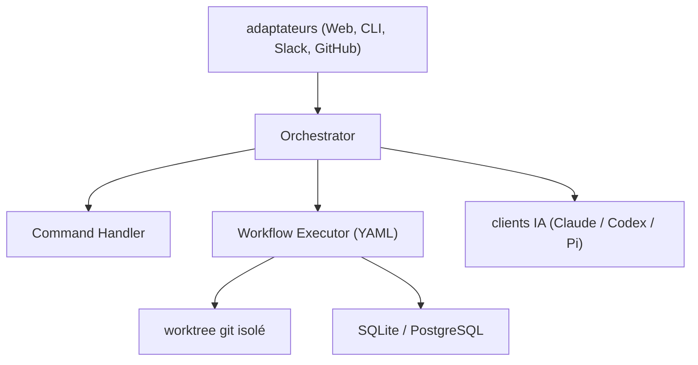

# coleam00/Archon

> YAML workflow engine for coding agents, to make their runs reproducible.

## The problem
Asking an agent to "fix this bug" gives a different result on each run: it skips
planning, forgets the tests, ignores the PR template. Nothing is replayable.

## What it actually does
Workflows described in YAML in `.archon/workflows/`: deterministic nodes (`bash:`) and
AI nodes (`prompt:`), with `depends_on`, loops `until: ALL_TASKS_COMPLETE`, human
gates `interactive: true` and `fresh_context: true`. Each run gets its own git
worktree. 19 workflows shipped (`archon-idea-to-pr`, `archon-fix-github-issue`, `archon-smart-pr-review`…).
Web UI, CLI, Telegram, Slack, Discord and GitHub adapters; state in SQLite or PostgreSQL (14 tables).

## How it is wired


## Trying it
```bash
git clone https://github.com/coleam00/Archon
cd Archon
bun install
claude
```
```bash
curl -fsSL https://archon.diy/install | bash
archon serve
archon workflow list
```

## Cost and gotchas
Bun, the GitHub CLI and Claude Code must be installed separately; compiled binaries require an explicit
`CLAUDE_BIN_PATH`. The x64 quick install requires AVX2. The bill is that of the underlying
agent, multiplied by the number of loop iterations. PostHog telemetry enabled by default
(`ARCHON_TELEMETRY_DISABLED=1`, `DO_NOT_TRACK=1`).

## What it is not
Not an agent: Archon sequences, the intelligence comes from Claude Code, Codex or Pi. Not the old Archon —
the Python version (task management + RAG) is archived on `archive/v1-task-management-rag`.
Not to be launched from its own repository: the README insists, you work from the target repo.

## Alternatives
- n8n: the comparison claimed by the README, on the general workflow side.

## For you
The idea of a worktree per run and of validation gates is worth borrowing, even without adopting the tool.
