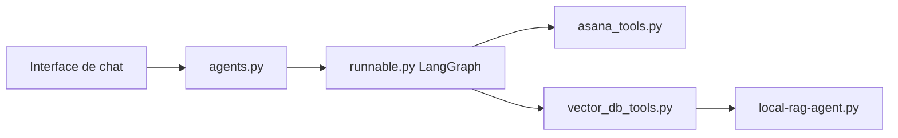

# coleam00/ai-agents-masterclass

> Companion code for a YouTube video series on building AI agents.

## The problem
Learning to build LLM agents with step-by-step worked examples.

## What it actually does
Each numbered folder matches a video (LangChain agent, LangGraph, local RAG, Asana tools, evaluation, chat interface). Other folders are side content, including a GoHighLevel backend. The projects are independent, each with its own `.env.example` and `requirements.txt`.

## How it is wired


## Trying it
```bash
python -m venv ai-agents-masterclass
cd 1-first-agent
pip install -r requirements.txt
python [script name].py
```

## Cost and gotchas
The examples require API keys (variables from `.env.example`). Last push on 2025-01-14, more than a year ago: dependencies are probably outdated.

## What it is not
Not a library nor an integrated application: independent demos, tied to the videos.

## Alternatives
No alternative cited in the README.

## For you
Ignore: a training resource not updated for more than a year, while agent tooling moves fast.
