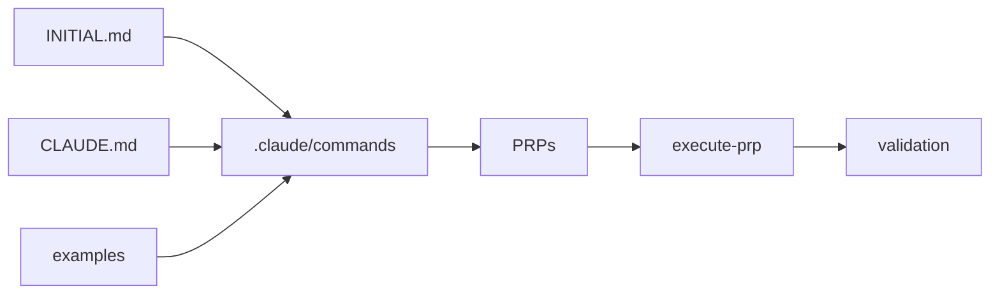

# coleam00/context-engineering-intro

> "Context engineering" template for Claude Code: rules, examples, PRPs generated then executed.

## The problem
A coding assistant often fails for lack of context: conventions, examples and validation criteria are missing.

## What it actually does
`CLAUDE.md` sets the global rules; `INITIAL.md` describes the desired feature; `examples/` serves as a library of patterns.
Command `/generate-prp`: researches the code and docs, produces a PRP (Product Requirements Prompt) with steps and validations.
`/execute-prp`: implements, tests, fixes until the criteria are met.
`use-cases/` folders: Pydantic AI agents, a RAG agent, a Cloudflare MCP server.

## How it is wired


## Trying it
```bash
git clone https://github.com/coleam00/Context-Engineering-Intro.git
cd Context-Engineering-Intro
/generate-prp INITIAL.md
/execute-prp PRPs/your-feature-name.md
```

## Cost and gotchas
Free; assumes a Claude Code subscription or key.

## What it is not
Not a software tool: a method and template files. The README's "10x better" is an opinion.

## Alternatives
No alternative named in the README.

## For you
Worth watching: the PRP commands are a good model for your own Claude Code skills, to be partly reused rather than wholesale.
