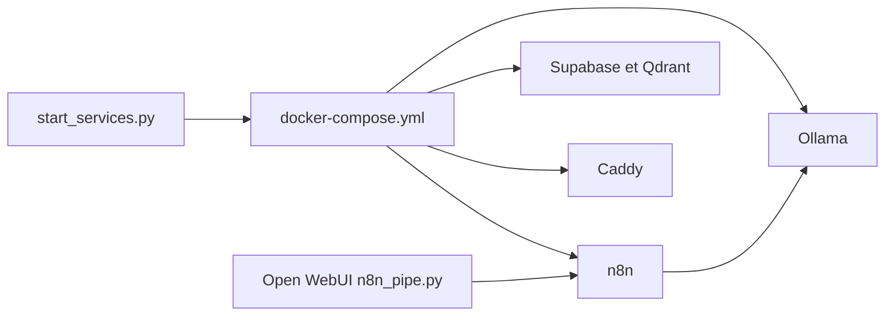

# coleam00/local-ai-packaged

> Docker Compose template that spins up n8n, Ollama, Supabase, Open WebUI and other AI building blocks locally.

## The problem
Setting up a local AI stack by hand (LLM, vector database, workflows, observability) takes days of network and secrets configuration.

## What it actually does
`start_services.py` picks a profile (`cpu`, `gpu-nvidia`, `gpu-amd`, `none`) and a mode (`private` or `public`), starts Supabase, then the Compose stack: n8n, Ollama, Open WebUI, Flowise, Qdrant, Neo4j, SearXNG, Langfuse, Caddy. Three RAG agent workflows are provided as JSON; `n8n_pipe.py` connects Open WebUI to an n8n webhook.

## How it is wired


## Trying it
```bash
git clone -b stable https://github.com/coleam00/local-ai-packaged.git
cd local-ai-packaged
cp .env.example .env
python start_services.py --profile gpu-nvidia
python start_services.py --profile cpu
```

## Cost and gotchas
Lots of containers, so lots of RAM. All the secrets in `.env` must be generated; the example values are not meant for production. The ufw firewall does not protect ports published by Docker: `public` mode closes everything except 80 and 443. Some Supabase variables have changed over time (updates are flagged in the README).

## What it is not
The author himself writes that it is not optimized for a production environment, only for proofs of concept. The n8n "Execute Command" nodes are disabled by default.

## Alternatives
The n8n team's "Local AI Starter Kit", of which this repository is an enriched version.

## For you
Adopt it as a local lab for prototyping RAG agents: Apache-2.0, active until May 2026, but do not expose it as-is on the Internet.
