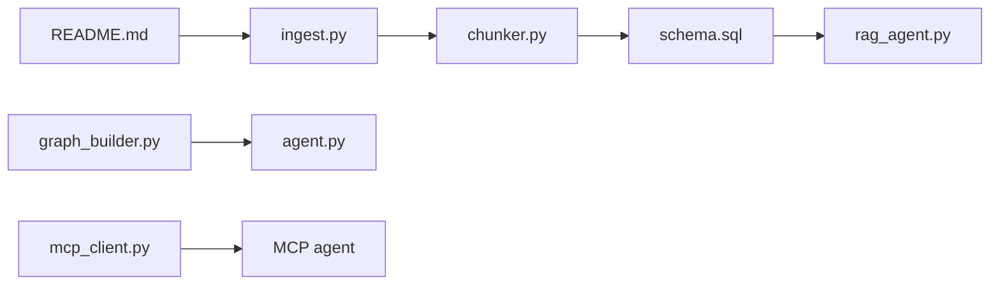

# coleam00/ottomator-agents

> Collection of open source AI agents (Python, n8n, Voiceflow) published on Live Agent Studio.

## The problem
Agent demos are scattered around, and rarely come with the full code of a working RAG or MCP agent.

## What it actually does
Each folder is a standalone agent: Python scripts, Streamlit apps, n8n workflow exports.
Several complete RAG pipelines (ingestion, chunking, SQL/vector storage), including a knowledge-graph variant.
Pydantic AI agents, parallel LangGraph, MCP clients; a Next.js UI (AG-UI).
Python and n8n starter templates for publishing on the platform.

## How it is wired

## Trying it
No command in the root README: each agent has its own procedure.

## Cost and gotchas
LLM provider keys per agent (`.env.example`); the Live Agent Studio platform runs on paid tokens.

## What it is not
Not a coherent library: quality and dependencies vary from one folder to the next. The README is mostly promotional.

## Alternatives
No alternative named in the README.

## For you
Worth watching as a bank of examples: the RAG folders (docling, all-rag-strategies) are worth a read, the rest is educational material.
