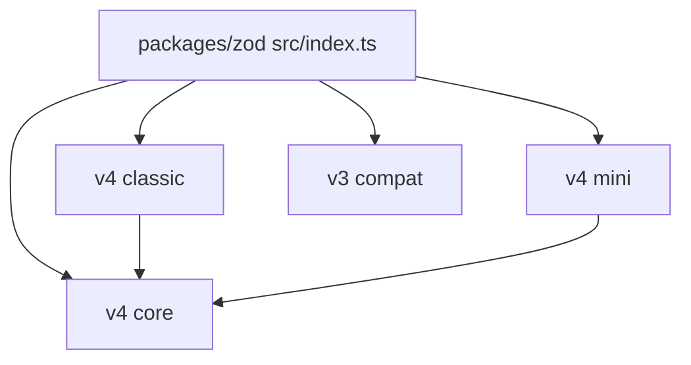

# colinhacks/zod

> TypeScript schema validation library with type inference, for JavaScript developers.

## The problem
External data does not respect TypeScript types at runtime; you need to validate and type from a single definition.

## What it actually does
The provided README is empty (a single line: `packages/zod/README.md`). From the architecture: schema definition, synchronous and asynchronous parsing, normalized errors, JSON Schema generation, locales, v4 versions (core, classic, mini) and v3 compatibility.

## How it is wired

## Trying it
No command documented in the provided README.

## Cost and gotchas
Free. Insufficient material to detail installation: refer to the repository documentation.

## What it is not
Not an API framework. Content not verified beyond the architecture.

## Alternatives
No alternative named in the README.

## For you
Watch: very useful for typing JSON payloads on the TypeScript side (APIs, AI tool front ends), but the sheet is undocumented.
