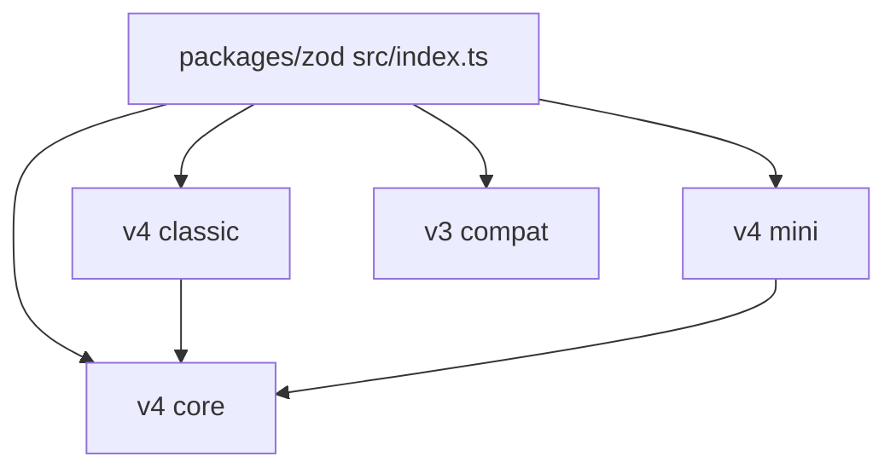

# colinhacks/zod

> Bibliothèque TypeScript de validation de schémas avec inférence de types, pour développeurs JavaScript.

## Le problème
Les données externes ne respectent pas les types TypeScript à l'exécution ; il faut valider et typer à partir d'une seule définition.

## Ce que ça fait vraiment
Le README fourni est vide (une seule ligne : `packages/zod/README.md`). D'après l'architecture : définition de schémas, parsing synchrone et asynchrone, erreurs normalisées, génération de JSON Schema, locales, versions v4 (core, classic, mini) et v3 de compatibilité.

## Comment c'est branché

## Essayer
Aucune commande documentée dans le README fourni.

## Coût et pièges
Gratuit. Matière insuffisante pour détailler l'installation : se référer à la documentation du dépôt.

## Ce que ce n'est pas
Pas un framework d'API. Contenu non vérifié au-delà de l'architecture.

## Alternatives
Aucune alternative nommée dans le README.

## Pour toi
À surveiller : très utile pour typer des charges JSON côté TypeScript (API, front d'outils IA), mais fiche non documentée.

