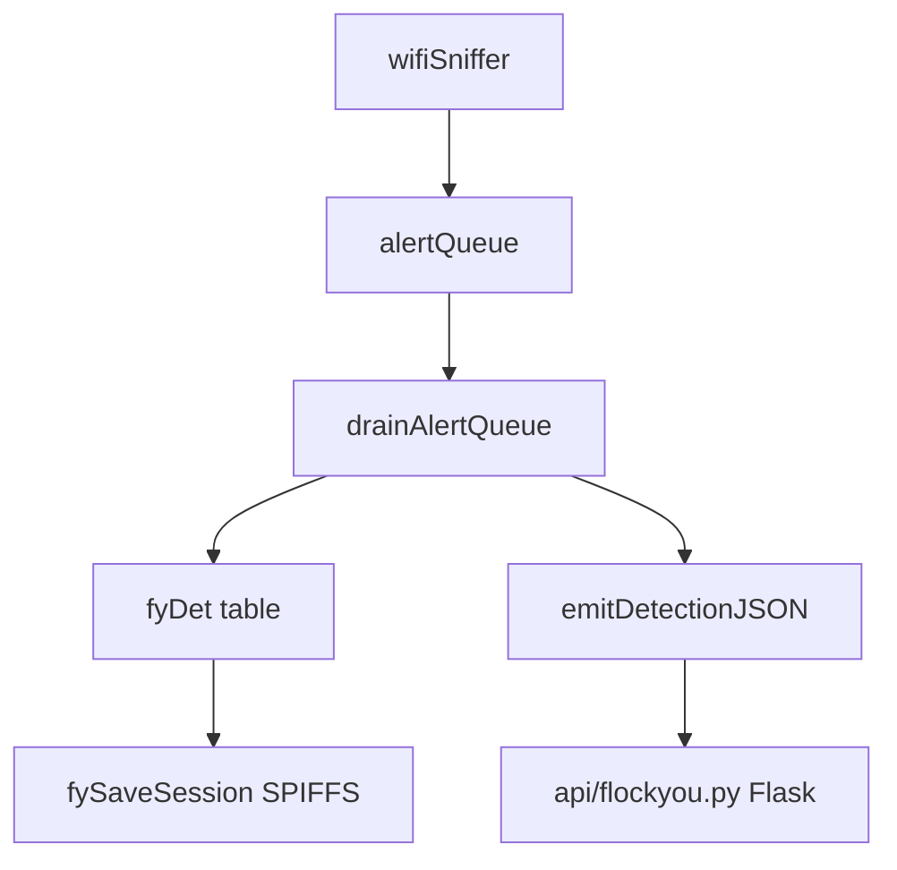

# colonelpanichacks/flock-you

> ESP32-S3 firmware that passively detects Flock license plate reader cameras over WiFi, with a Flask dashboard.

## The problem
Knowing where surveillance cameras are installed without spotting them by eye: their radio signatures are not visible.

## What it actually does
A Seeed XIAO ESP32-S3 board listens to 2.4 GHz frames in promiscuous mode and compares MAC addresses against 34 OUI prefixes. It also spots generic probe requests based on a fingerprint of the information fields. Each detection gets a confidence level from 0 to 4, a buzzer sound, a SPIFFS backup and a JSON line sent over USB to a Flask dashboard that adds GPS.

## How it is wired
Simplified diagram based on the sheet, no diagram provided.



## Trying it
```bash
pio run -e xiao_esp32s3
pio run -e xiao_esp32s3 -t upload
pio device monitor
cd api
pip install -r requirements.txt
python flockyou.py
```

## Cost and gotchas
Hardware to buy (XIAO ESP32-S3, buzzer) and PlatformIO. The LilyGO T-Dongle S3 does not compile yet. The README states research and education use, at your own responsibility.

## What it is not
Not a generic WiFi scanning tool. The targeted cameras are mostly American and Canadian: elsewhere, nothing will match. Level 1 and 2 methods are echoes that produce false positives.

## Alternatives
No alternative named, except the upstream projects in the README (nite-oui-collection, DeFlock).

## For you
Ignore: this is a radio-detection hardware project, unrelated to data / AI / MLOps work.
