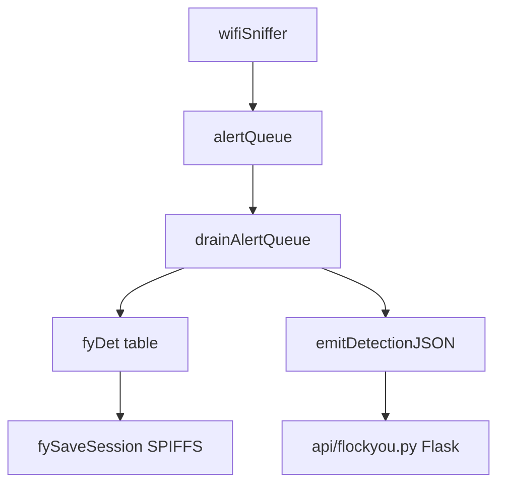

# colonelpanichacks/flock-you

> Firmware ESP32-S3 qui détecte passivement en WiFi les caméras de lecture de plaques Flock, avec tableau de bord Flask.

## Le problème
Savoir où sont posées des caméras de surveillance sans les repérer à l'œil : leurs signatures radio ne sont pas visibles.

## Ce que ça fait vraiment
Une carte Seeed XIAO ESP32-S3 écoute en mode promiscuité les trames 2,4 GHz et compare les adresses MAC à 34 préfixes OUI. Elle repère aussi les requêtes de sonde génériques selon une empreinte des champs d'information. Chaque détection reçoit un niveau de confiance de 0 à 4, un son de buzzer, une sauvegarde SPIFFS et une ligne JSON envoyée en USB à un tableau de bord Flask qui ajoute le GPS.

## Comment c'est branché
Schéma simplifié d'après la fiche, sans diagramme fourni.



## Essayer
```bash
pio run -e xiao_esp32s3
pio run -e xiao_esp32s3 -t upload
pio device monitor
cd api
pip install -r requirements.txt
python flockyou.py
```

## Coût et pièges
Matériel à acheter (XIAO ESP32-S3, buzzer) et PlatformIO. La LilyGO T-Dongle S3 ne se compile pas encore. Le README annonce un usage de recherche et d'éducation, à ta responsabilité.

## Ce que ce n'est pas
Pas un outil générique de scan WiFi. Les caméras visées sont surtout américaines et canadiennes : ailleurs, rien ne correspondra. Les méthodes de niveau 1 et 2 sont des échos qui produisent des faux positifs.

## Alternatives
Aucune alternative nommée, sauf les projets amont du README (nite-oui-collection, DeFlock).

## Pour toi
À ignorer : c'est un projet de matériel de radio-détection, sans rapport avec le travail data / IA / MLOps.

