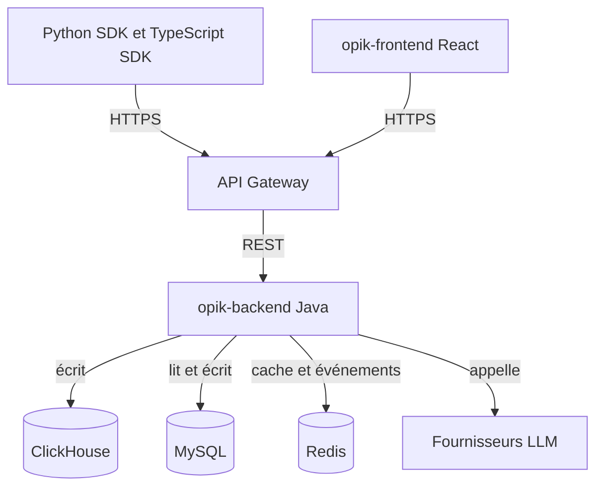

# comet-ml/opik

> Open-source platform for tracing, evaluating and monitoring LLM applications and agents.

## The problem
Without dedicated tooling, it is impossible to know why an agent answered badly, to compare two versions of a prompt, or to monitor quality in production.

## What it actually does
You decorate your functions with `@track` and every LLM call, nested or not, is traced. The platform handles datasets, experiments, LLM-judge metrics (hallucination, relevance), online evaluation rules, prompt management, guardrails and an agent optimizer. It offers integrations with dozens of frameworks, OpenTelemetry and an MCP server. The Java backend uses MySQL, ClickHouse, Redis and S3.

## How it is wired


## Trying it
```bash
pip install opik
opik configure
git clone https://github.com/comet-ml/opik.git
cd opik
./opik.sh
uvx opik mcp configure
```

## Cost and gotchas
Self-hosting is free but launches several containers (MySQL, ClickHouse, Redis), hence a lot of resources. Comet's cloud has a free tier and then paid plans. LLM-judge metrics consume calls to your models, at your expense.

## What it is not
It is not an agent orchestrator: it observes and evaluates, it does not execute. The figure of 40 million traces per day is a claim made by the README.

## Alternatives
Langfuse (MIT core), Phoenix (Elastic License 2.0) and LangSmith (closed, self-hosting reserved for enterprises).

## For you
Worth adopting to trace and evaluate agents: a complete platform, self-hostable under Apache-2.0, with a pytest integration to test on every commit.
