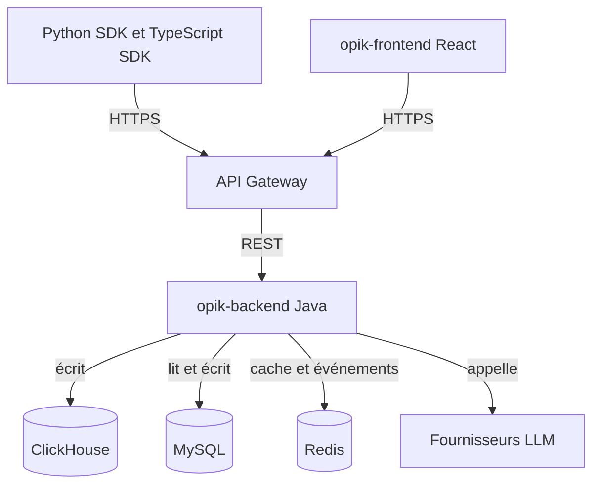

# comet-ml/opik

> Plateforme open source de traçage, d'évaluation et de suivi d'applications et d'agents LLM.

## Le problème
Impossible de savoir pourquoi un agent a mal répondu, de comparer deux versions d'un prompt ou de surveiller la qualité en production sans outillage dédié.

## Ce que ça fait vraiment
On décore ses fonctions avec `@track` et chaque appel LLM, imbriqué ou non, est tracé. La plateforme gère jeux de données, expériences, métriques LLM-juge (hallucination, pertinence), règles d'évaluation en ligne, gestion de prompts, garde-fous et optimiseur d'agents. Elle propose des intégrations avec des dizaines de frameworks, OpenTelemetry et un serveur MCP. Le backend Java utilise MySQL, ClickHouse, Redis et S3.

## Comment c'est branché


## Essayer
```bash
pip install opik
opik configure
git clone https://github.com/comet-ml/opik.git
cd opik
./opik.sh
uvx opik mcp configure
```

## Coût et pièges
L'auto-hébergement est gratuit mais lance plusieurs conteneurs (MySQL, ClickHouse, Redis), donc beaucoup de ressources. Le cloud de Comet a un forfait gratuit puis des offres payantes. Les métriques LLM-juge consomment des appels à tes modèles, à ta charge.

## Ce que ce n'est pas
Ce n'est pas un orchestrateur d'agents : il observe et évalue, il n'exécute pas. Le chiffre de 40 millions de traces par jour est une affirmation du README.

## Alternatives
Langfuse (cœur MIT), Phoenix (licence Elastic 2.0) et LangSmith (fermé, auto-hébergement réservé aux entreprises).

## Pour toi
À adopter pour tracer et évaluer des agents : plateforme complète, auto-hébergeable sous Apache-2.0, avec une intégration pytest pour tester à chaque commit.

