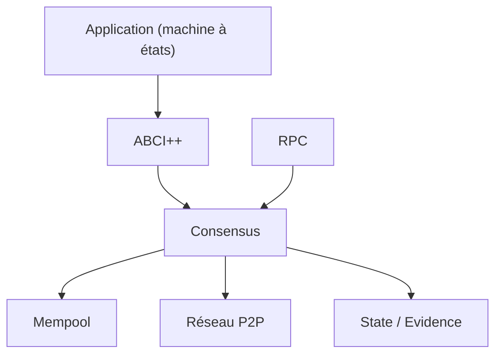

# cometbft/cometbft

> BFT consensus engine (a Tendermint fork) that replicates a state machine across several nodes.

## The problem
Getting machines that do not trust each other to agree on the order of transactions, whatever the application's language.

## What it actually does
Byzantine-fault-tolerant consensus middleware: the application, written in any language, plugs in through ABCI++. The README claims up to 10,000 TPS. The generated diagram (with no readable components) describes consensus, mempool, P2P, state sync, evidence pool and RPC. Maintained by Cosmos Labs.

## How it is wired

## Trying it
No command in the README; it points to the installation guide and to starting a single node or a docker-compose cluster. Go 1.26.6+ required on `main`.

## Cost and gotchas
Do not use `main` in production. A minor version change can break compatibility with an existing chain. 281 open issues.

## What it is not
Neither a full blockchain nor a data analysis tool: it is the consensus layer.

## Alternatives
The README cites Tendermint Core (of which it is the fork) and the Cosmos SDK, IBC and Cosmos EVM libraries as complements.

## For you
Ignore: blockchain infrastructure unrelated to data, AI or MLOps work.
