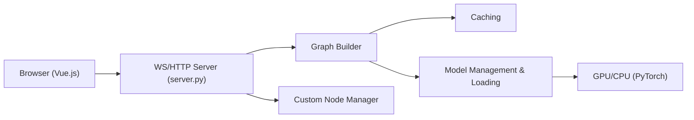

# comfyanonymous/ComfyUI

> Visual generation engine based on a node graph, for images, video, audio, and 3D content, whether locally or in the cloud.

## The problem
Using diffusion models, ControlNet, LoRA, and upscalers in a sequence requires a reusable and reproducible visual tool.

## What it actually does
Node graph interface with a Python server, asynchronous execution via a queue, partial re-execution of the graph (only the modified parts), and VRAM management with offloading. Supports many models (SD, SDXL, Flux, Wan, LTX, HunyuanVideo, etc.). Workflows in JSON, custom node extensions, optional ComfyUI-Manager. GPU support for NVIDIA, AMD, Intel, Apple, and Ascend.

## How it is wired


## Trying it
```bash
pip install comfy-cli
comfy install
pip install -r requirements.txt
python main.py
```

## Cost and gotchas
Free locally; models available for download in multiple GB, and a GPU is recommended. Partner API nodes are paid (and can be disabled with `--disable-api-nodes`), Comfy Cloud is a paid service. Commits outside of stable versions may break custom nodes. The information in the catalog is missing here.

## What it is not
This is not a managed service: you are responsible for managing the models, dependencies, and updates. The README does not specify its license.

## Alternatives
No alternative is specified in the README file.

## For you
If you are using generative visual AI: this is the standard, due to its model coverage; check the license in the repository before using it commercially.
