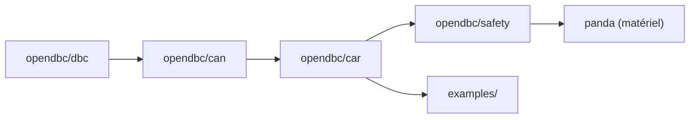

# commaai/opendbc

> Python API to read and control cars' steering, throttle and brakes, for openpilot developers.

## The problem
Each brand encodes its CAN messages differently, and driving a car requires a reliable safety layer.

## What it actually does
It describes CAN messages in DBC files, reads and writes them through a CAN library, then exposes per-brand interfaces (`carstate`, `carcontroller`, `fingerprints`). Safety firmware in C, tested with MISRA and 100% coverage, controls what can be sent. Bounties reward car ports.

## How it is wired


## Trying it
```bash
git clone https://github.com/commaai/opendbc.git
cd opendbc
./test.sh
pip3 install -e .[testing]
scons -j8
```

## Cost and gotchas
The code is free. Driving a real car requires a comma four and a harness, sold by comma. Built with scons.

## What it is not
Not a consumer app: it is a low-level building block. The list of supported cars is in a separate document.

## Alternatives
No alternative named in the README.

## For you
Worth watching if you work with vehicle data or robotics: the DBCs and the commaCarSegments dataset are also useful outside driving.
