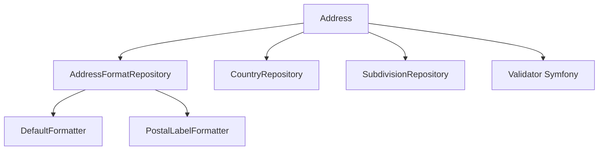

# commerceguys/addressing

> PHP 8 library to manipulate, format and validate postal addresses for more than 200 countries.

## The problem
Address formats, subdivisions and postal codes vary from one country to another.

## What it actually does
Provides repositories of countries (translated into more than 150 locales, CLDR v48), address formats and subdivisions for 62 countries, HTML or text formatters (including the postal label following Universal Postal Union rules), validation via Symfony Validator, and zones (for example VAT or shipping costs).

## How it is wired

Simplified diagram based on the sheet, no diagram provided.

## Trying it
```bash
# Aucune commande shell dans le README ; exemples PHP :
# new CountryRepository(); $countryRepository->getList('fr-FR');
```

## Cost and gotchas
Free. PHP 8.0 and above. The format data comes from Google, now maintained by the project.

## What it is not
Not a geocoding service nor a check that an address exists: it validates the form.

## Alternatives
- commerceguys/intl: for languages, currencies and number formats.

## For you
Ignore: a PHP library for online stores; its data could inspire address cleaning, nothing more.
