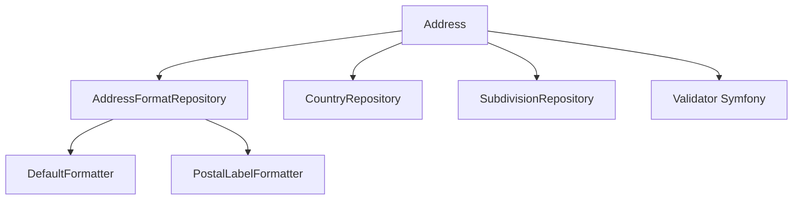

# commerceguys/addressing

> Bibliothèque PHP 8 pour manipuler, formater et valider des adresses postales de plus de 200 pays.

## Le problème
Les formats d'adresse, les subdivisions et les codes postaux varient d'un pays à l'autre.

## Ce que ça fait vraiment
Fournit des dépôts de pays (traduits en plus de 150 locales, CLDR v48), de formats d'adresse et de subdivisions pour 62 pays, des formateurs HTML ou texte (dont l'étiquette postale aux règles de l'Union postale universelle), une validation via Symfony Validator et des zones (par exemple TVA ou frais de port).

## Comment c'est branché

Schéma simplifié d'après la fiche, sans diagramme fourni.

## Essayer
```bash
# Aucune commande shell dans le README ; exemples PHP :
# new CountryRepository(); $countryRepository->getList('fr-FR');
```

## Coût et pièges
Gratuit. PHP 8.0 et plus. Les données de format viennent de Google, désormais maintenues par le projet.

## Ce que ce n'est pas
Pas un service de géocodage ni de vérification d'existence d'une adresse : il valide la forme.

## Alternatives
- commerceguys/intl : pour les langues, devises et formats de nombres.

## Pour toi
Ignorer : bibliothèque PHP pour boutiques en ligne ; ses données pourraient inspirer un nettoyage d'adresses, sans plus.

