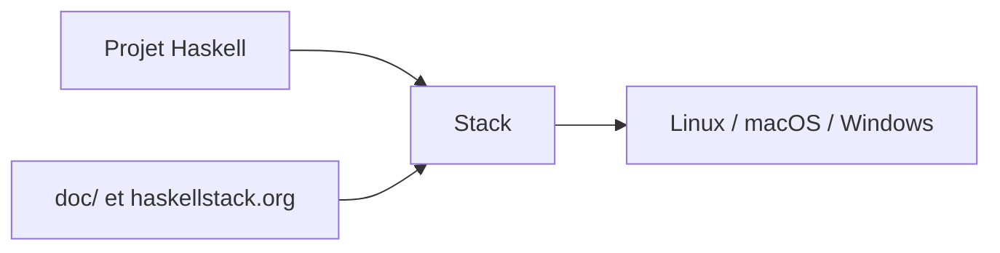

# commercialhaskell/stack

> A program for developing Haskell projects, for beginners and experts, on Linux, macOS and Windows.

## The problem
Building and managing Haskell projects reproducibly across several systems.

## What it actually does
Not documented in the README, which is limited to a three-line introduction, a pointer to haskellstack.org and the `doc/` directory, and a link to the Haskell Community forum. The repo is active (last push 2026-10-22), with more than 600 open issues.

## How it is wired

## Trying it
No command documented in the README; installation is described on the official site.

## Cost and gotchas
Free. License present but not identified by GitHub. Usage details must be looked up in the external documentation.

## What it is not
Not a data/AI tool. No functional description in this README.

## Alternatives
None cited in the README.

## For you
Ignore: a Haskell tool, outside your scope, and the README is too thin to judge more finely.
