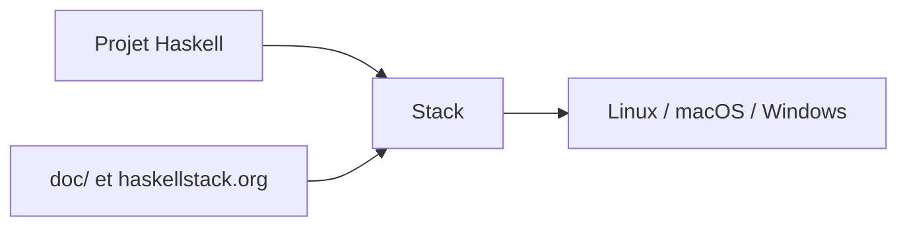

# commercialhaskell/stack

> Programme de développement de projets Haskell, pour débutants et experts, sur Linux, macOS et Windows.

## Le problème
Construire et gérer des projets Haskell de manière reproductible, sur plusieurs systèmes.

## Ce que ça fait vraiment
Non documenté dans le README, qui se limite à une présentation de trois lignes, un renvoi à haskellstack.org et au répertoire `doc/`, et un lien vers le forum Haskell Community. Le dépôt est actif (dernier push 2026-10-22), avec plus de 600 issues ouvertes.

## Comment c'est branché

## Essayer
Aucune commande documentée dans le README ; l'installation est décrite sur le site officiel.

## Coût et pièges
Gratuit. Licence présente mais non identifiée par GitHub. Détails d'usage à chercher dans la documentation externe.

## Ce que ce n'est pas
Pas un outil data/IA. Pas de description fonctionnelle dans ce README.

## Alternatives
Aucune citée dans le README.

## Pour toi
Ignorer : outil Haskell, hors de ton périmètre, et README trop mince pour être jugé plus finement.

