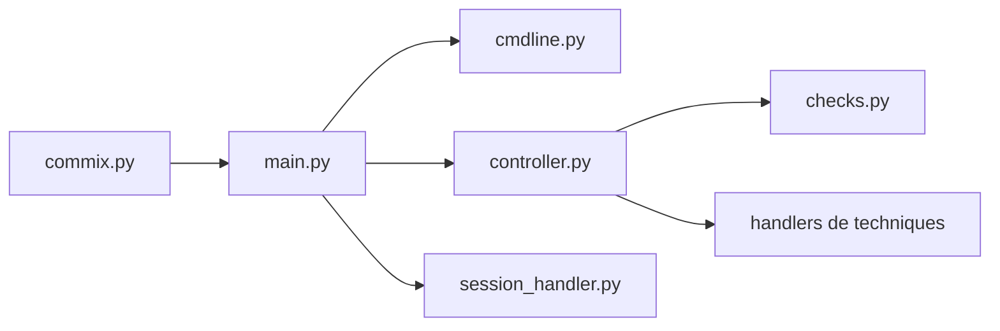

# commixproject/commix

> Python penetration-testing tool that detects command and code injection, for authorised audits.

## The problem
Command injection flaws in web applications are tedious to detect by hand across many parameters and targets.

## What it actually does
Commix analyses targets (URL, forms, crawl, sitemap, request file, stdin) and tests whether parameters, headers, cookies or JSON/XML bodies are vulnerable, using four techniques: direct result, time-based, file-based and out-of-band (OAST). It also offers code injection detection (PHP, Python), dedicated modules, bypass filters (tampers), enumeration and file access on the target, as well as resumable sessions and JSON export.

## How it is wired


## Trying it
```bash
git clone https://github.com/commixproject/commix.git commix
python3 commix.py -h
```
Python 3.7 or later; dependencies are included. The README's exploitation examples are not reproduced here.

## Cost and gotchas
Free. The project is under active development with possible breaking changes between revisions. The README advises against running it as a service and against using it on systems you do not own or are not explicitly authorised to test. OAST detection goes through the public server `oast.fun` by default: metadata about the target leaves the network, unless you self-host a server.

## What it is not
Not a general-purpose vulnerability scanner: it targets only command and code injection. The licence is not identified by GitHub: check it before any professional use.

## Alternatives
No alternative named in the README.

## For you
Worth watching: web pentest tool with no direct link to data/AI/MLOps; keep in mind only for a mandated audit of an application exposing a model or an API.
