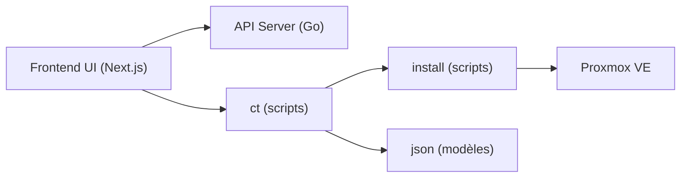

# community-scripts/ProxmoxVE

> Collection of Bash scripts that install services into Proxmox VE containers or VMs, for homelabs.

## The problem
Installing a self-hosted service in a Proxmox LXC means hunting for packages and editing configuration files by hand.

## What it actually does
One script per service (Home Assistant, Jellyfin, Grafana, PostgreSQL, n8n…) creates the container or VM, installs the application and leaves an update assistant. Two modes: default (reasonable resources) or advanced (network, storage). The scripts are found through the community-scripts.org site. The repository also contains a Next.js frontend and a Go API.

## How it is wired

## Trying it
The README gives no literal command: you copy the command from a script page on community-scripts.org and paste it into the Proxmox shell (root access, Proxmox VE 8.4 to 9.2).

## Cost and gotchas
Free; Internet connection during installation. The scripts run as root on the host: read them before running. New scripts go in DevScripts, not here.

## What it is not
Not a general-purpose tool: it only serves Proxmox VE. Not an orchestrator or a backup manager.

## Alternatives
No alternative named in the README.

## For you
Adopt it if you build a Proxmox homelab to host MLflow, Grafana or databases: it saves time, provided you read every script you run as root.
