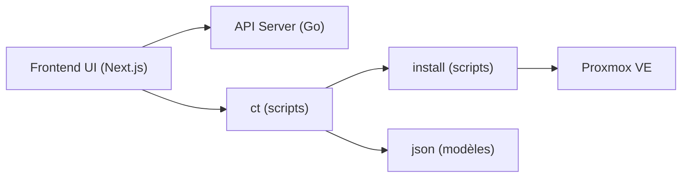

# community-scripts/ProxmoxVE

> Collection de scripts Bash qui installent des services dans des conteneurs ou VM Proxmox VE, pour homelabs.

## Le problème
Installer un service auto-hébergé dans un LXC Proxmox implique de chasser les paquets et d'éditer des fichiers de configuration à la main.

## Ce que ça fait vraiment
Un script par service (Home Assistant, Jellyfin, Grafana, PostgreSQL, n8n…) crée le conteneur ou la VM, installe l'application et laisse un assistant de mise à jour. Deux modes : par défaut (ressources raisonnables) ou avancé (réseau, stockage). Les scripts se trouvent via le site community-scripts.org. Le dépôt contient aussi un frontend Next.js et une API Go.

## Comment c'est branché

## Essayer
Le README ne donne pas de commande littérale : on copie la commande d'une page de script sur community-scripts.org et on la colle dans le shell Proxmox (accès root, Proxmox VE 8.4 à 9.2).

## Coût et pièges
Gratuit ; connexion Internet pendant l'installation. Les scripts s'exécutent en root sur l'hôte : à relire avant d'exécuter. Les nouveaux scripts vont dans DevScripts, pas ici.

## Ce que ce n'est pas
Ce n'est pas un outil généraliste : il ne sert que sur Proxmox VE. Ce n'est pas un orchestrateur ni un gestionnaire de sauvegarde.

## Alternatives
Aucune alternative nommée dans le README.

## Pour toi
À adopter si tu montes un homelab Proxmox pour héberger MLflow, Grafana ou des bases : il fait gagner du temps, à condition de relire chaque script lancé en root.

